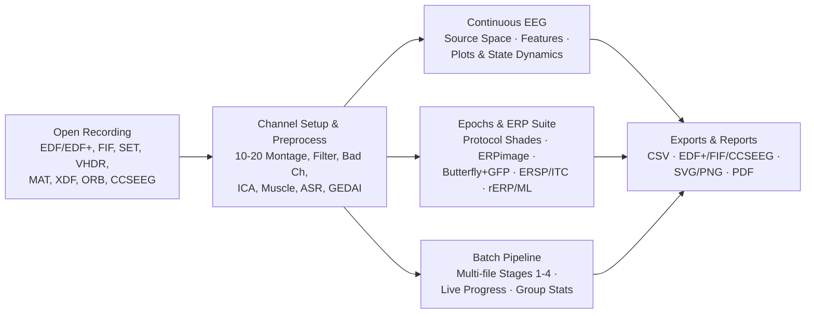
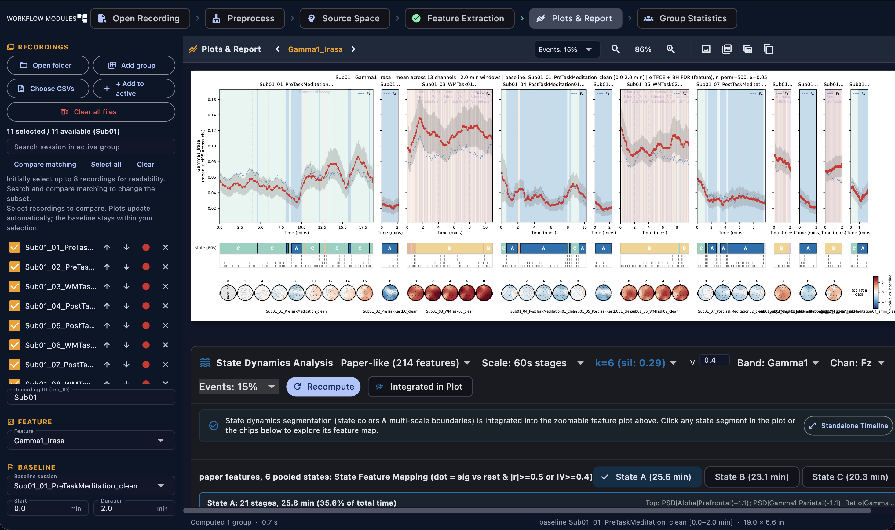
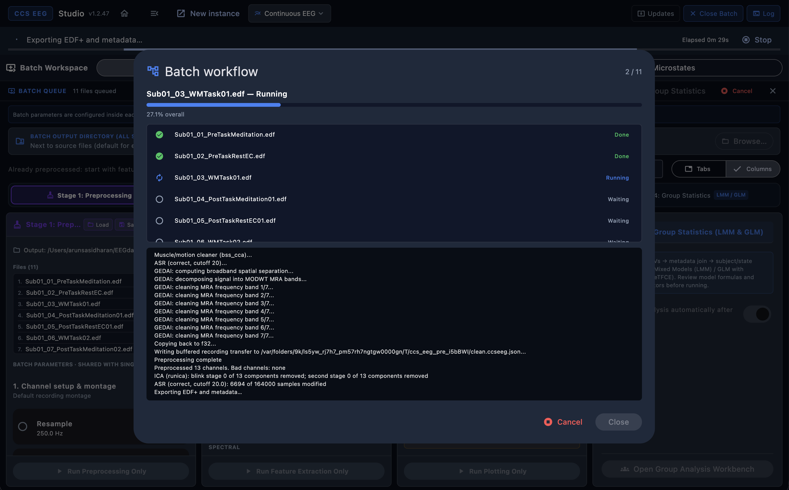
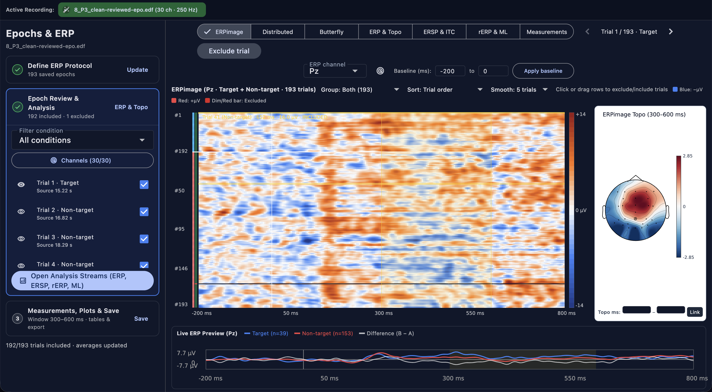

<p align="center">
  
</p>

<h1 align="center">CCS EEG Studio</h1>

<p align="center">
  <b>Native-speed EEG preprocessing, feature extraction, state dynamics, ERP/ERSP/rERP/ML analysis, and reporting</b>
</p>

<p align="center">
  A Research & Engineering Collaboration of<br>
  <b>Centre for Consciousness Studies (CCS)</b>, Department of Neurophysiology,<br>
  <b>National Institute of Mental Health and Neurosciences (NIMHANS)</b>, Bengaluru, India &nbsp;🤝&nbsp;
  <a href="https://axxonet.com/"><b>Axxonet</b></a>
</p>

<p align="center">
  <a href="https://github.com/CCS-NIMHANS/CCS_EEGStudio/releases/latest"></a>
  <a href="https://github.com/CCS-NIMHANS/CCS_EEGStudio/actions/workflows/build.yml"></a>
  <a href="https://github.com/CCS-NIMHANS/CCS_EEGStudio/releases"></a>
  <a href="https://joss.theoj.org/"></a>
</p>

<p align="center">
  <b>Current version: 1.2.60</b> ·
  <a href="docs/wiki/Home.md"><b>Visual Wiki</b></a> ·
  <a href="CHANGELOG.md"><b>Release Notes</b></a> ·
  <a href="docs/methods_and_validation.md"><b>Methods &amp; Validation</b></a> ·
  <a href="docs/RELEASE_SOP.md"><b>Release CI SOP</b></a> ·
  <a href="paper/paper.md"><b>JOSS Paper</b></a> ·
  <a href="https://github.com/CCS-NIMHANS/CCS_EEGStudio/issues"><b>Report Issue</b></a>
</p>

---

## 📥 Quick Download

| Platform | Package | Direct Download |
| :--- | :--- | :--- |
| **macOS** | Apple Silicon ZIP (macOS 12+) | [CCSEEGStudio-macos.zip](https://github.com/CCS-NIMHANS/CCS_EEGStudio/releases/latest/download/CCSEEGStudio-macos.zip) |
| **Windows** | 64-bit Installer (Windows 10/11) | [CCSEEGStudio-Installer.exe](https://github.com/CCS-NIMHANS/CCS_EEGStudio/releases/latest/download/CCSEEGStudio-Installer.exe) |
| **Linux (Debian / Ubuntu)** | amd64 `.deb` | [CCSEEGStudio-linux-amd64.deb](https://github.com/CCS-NIMHANS/CCS_EEGStudio/releases/latest/download/CCSEEGStudio-linux-amd64.deb) |
| **Linux (RHEL / AlmaLinux)** | x86_64 `.rpm` | [CCSEEGStudio-linux-x86_64.rpm](https://github.com/CCS-NIMHANS/CCS_EEGStudio/releases/latest/download/CCSEEGStudio-linux-x86_64.rpm) |

> 📦 Checksums (`SHA256SUMS.txt`) and all assets are on the **[GitHub Releases Page](https://github.com/CCS-NIMHANS/CCS_EEGStudio/releases/latest)**. Use **Updates** in the app header for in-app upgrades.

<details>
<summary><b>🍏 macOS Gatekeeper Setup & 🐧 Multi-User Linux Server Install</b></summary>

**macOS (first launch):**
```sh
xattr -rd com.apple.quarantine ~/Downloads/CCS\ EEG\ Studio.app
mv ~/Downloads/CCS\ EEG\ Studio.app /Applications/
```

**Linux multi-user server (AlmaLinux / RHEL / Ubuntu / Debian):**
```bash
curl -fsSL https://raw.githubusercontent.com/CCS-NIMHANS/CCS_EEGStudio/main/scripts/install_linux.sh | sudo bash
# Update later:
sudo update-ccs-eeg-studio
```
Non-admin users can install/update per-user without `sudo` (see [Server Controls](docs/server_and_plot_controls.md)).

</details>

<p align="center">
  
</p>

---

## ✨ What's New in v1.2.61

- **eLORETA Inverse Model & Cleaner Glass Brain:** Implemented computationally efficient, average-reference-centered fixed-orientation **eLORETA** (Pascual-Marqui, 2007) alongside MNE, dSPM, sLORETA, LCMV, and XPIKAN; added a publication-ready model specification card (forward model, shell conductivities, atlas, $\lambda^2$, covariance) and upgraded Glass Brain with an interactive threshold slider, muted wireframe, single-row Sagittal/Coronal/Axial layout, and center `0` colorbar tick.
- **Unified Channel Setup, Live 2D Headmap & EGI Mapping:** Merged `CHANNEL TYPES` into `1. Channel setup & montage` with a live 2D headmap showing plottable vs unlocated channels, manual rename/type controls, and an `EGI HydroCel 128 -> 10-20` preset.
- **ICA & GEDAI Transparency:** Added explicit ICA high-pass (`1.0 Hz`) and safety-cap (`10%` components / `30%` variance) notes, renamed ICA-copy ASR to bad-segment removal, added GEDAI GEVD threshold presets, and upgraded ICA Component Review to show major ICLabel classes + `%` and total signal variance removed.

## ✨ What's New in v1.2.60

- Preserve all SET channel labels, including datasets with empty channel metadata.
- Compiled microstate group tables include syntax; compare recordings or participant means in the results workbench.
- Raw input opens as raw, interactive steps match finalisation, and global Start fresh clears each interactive analysis.
- Unsaved-preview close prompts, temporary-cache cleanup, selectable preprocessing working drive and disk-space checks.

- ERP factor aliases, corrected cell-specific contrast markers, fitted Python GLM/MixedLM and B-minus-A waveform models.
- Grouped publication figures export PNG, SVG and PDF for ERP/topography, ERSP/ITC, and saved rERP/ML results. Earlier native group statistics should be rerun with the fitted model.

## ✨ What's New in v1.2.59

- Load XDF recordings with small isolated timestamp reversals; timing repairs remain visible.
- Manage sessions across all subject groups, or directly from each stacked plot.

## ✨ What's New in v1.2.58

- Editable batch subject IDs persist into flat output folders; existing Sub/TKG exports group by subject.
- Compatibility video renderer refreshes frames during audio playback.
- GEDAI is opt-in for new configurations; existing settings are preserved.

## ✨ What's New in v1.2.57

- ERPimage and live ERP averages have aligned time axes; Butterfly offers condition averages from accepted trials.

- Paused timeline scrubbing shows a decoded frame for the selected video time.
- Speech tracking explains recording-wide cross-validation, moving-window evaluation and silence limitations in the UI.
- State Dynamics headings and state selectors wrap without distorting the feature mapping section.

## ✨ What's New in v1.2.56

Persistent **Start fresh**, independent audio/envelope/tracking visibility, accessible video playback controls, and corrected speech-tracking input resolution for feature CSVs.

## What's New in v1.2.55

Readable ICA/ERP scaling, matched-channel raw/clean comparison, per-file PDF reports, feature-plot media attachment, feature-specific settings, and corrected microstate map orientation with clearer sequence views. See [CHANGELOG.md](CHANGELOG.md) for details.

## What's New in v1.2.54

- **ERP workflow:** One stage navigator, direct loading from cleaned EEG / saved epochs / saved results, and a repaired preprocessing handoff. Compact measurement tables open group statistics without loading waveform arrays.
- **Interactive labels and groups:** No-regex filename setup, explicit label sources, participant/session identity, Excel cohort matching, and guided group-analysis results.
- **Connectivity and microstates:** Graph measures and Louvain communities, configurable ROIs and connectivity plots, plus clearer microstate maps, syntax and transition displays.

See [CHANGELOG.md](CHANGELOG.md) for full release notes and previous versions.

---

## 🧭 Visual Workflow & Wiki

**CCS EEG Studio** pairs a **Flutter** desktop UI with a **native Rust engine (`ccs-eeg-engine`)**—requiring no Python or MATLAB for core EEG workflows.



### 📖 Visual Wiki Guides

| Guide | Topics Covered |
| :--- | :--- |
| [**Wiki Home**](docs/wiki/Home.md) | Architecture overview, supported formats, and end-to-end workflow map |
| [**1. Continuous & Preprocessing**](docs/wiki/Continuous-and-Preprocessing.md) | Rust XDF import, unlocated channel guard, montage presets, ICA/ASR/GEDAI preview |
| [**2. Features & State Dynamics**](docs/wiki/Features-and-State-Dynamics.md) | PSD/FOOOF/IRASA, DFA/fE:I, connectivity, microstates, all-states feature mapping |
| [**3. Epochs & ERP Suite**](docs/wiki/Epochs-and-ERP-Suite.md) | Protocol shades, ERPimage, Butterfly + separate GFP, ERP & Topo, ERSP/ITC, rERP & ML |
| [**4. Batch & Group Statistics**](docs/wiki/Batch-and-Group-Statistics.md) | Multi-file Stage 1–4 pipeline, step toggles, progress monitor, grand-average review, shortcuts |
| [**5. Synced Video/Audio & Speech Tracking**](docs/wiki/Video-Audio-and-Speech-Tracking.md) | Timestamp-synced multi-video/audio, speech envelope, Neural Speech Tracking (TRF & Decoder) |

---

## 🖥️ Screenshots

| Main Workspace | Channel Setup & Montage |
| :---: | :---: |
|  |  |

| Preprocessing Options | Feature Extraction & State Dynamics |
| :---: | :---: |
|  |  |

| Batch Analysis Pipeline | Live Batch Progress |
| :---: | :---: |
|  |  |

| ERPimage (Grouped Events + Topo) | Butterfly Plot + Separate GFP |
| :---: | :---: |
|  |  |

| ERP Waveforms & Topographies | ERSP & ITC Linked Topos |
| :---: | :---: |
|  |  |

| rERP & ML Decoding | ERP Measurements & Export |
| :---: | :---: |
|  |  |

---

## 🚀 Building & Testing Locally

**Prerequisites:** Flutter SDK (`3.x+`) and Rust toolchain (`cargo` / `rustc`).

```bash
# 1. Build the native Rust engine
cargo build --release --manifest-path bridge/Cargo.toml

# 2. Run Flutter desktop app in development mode
flutter pub get
flutter run -d macos   # or windows / linux

# 3. Run mandatory pre-release CI preflight (Rust --release --locked + Flutter tests)
bash scripts/preflight_release.sh
```

<details>
<summary><b>📦 Packaging Production Releases (macOS / Windows / Linux)</b></summary>

```bash
./scripts/build_macos.sh                           # macOS (.app bundle)
iscc windows\installer.iss                         # Windows (Inno Setup .exe)
./scripts/build_linux_deb.sh                       # Debian / Ubuntu (.deb)
./scripts/build_linux_rpm.sh                       # RHEL / AlmaLinux (.rpm)
```

</details>

---

## 📚 Method References

| Category | App Method | Paper or Original Reference | Studio Convention / Scope |
| :--- | :--- | :--- | :--- |
| **Preprocessing** | Bad channel detection (PREP-style) | Bigdely-Shamlo et al. (2015), [doi:10.3389/fninf.2015.00016](https://doi.org/10.3389/fninf.2015.00016) | 2 s windowed robust MAD, HF noise ratio, and windowed spatial correlation on filtered `f64` channels + manual table. |
| **Preprocessing** | Spherical spline interpolation | Perrin et al. (1989), [doi:10.1016/0013-4694(89)90180-6](https://doi.org/10.1016/0013-4694(89)90180-6) | Legendre spherical spline matrix over 10–05 electrode geometry. |
| **Preprocessing** | Infomax ICA / `runica` | Bell & Sejnowski (1995), [doi:10.1162/neco.1995.7.6.1129](https://doi.org/10.1162/neco.1995.7.6.1129); [EEGLAB](https://github.com/sccn/eeglab) | Native `runica`/`pop_runica` port; fixed seed; two-stage CCS component selection. |
| **Preprocessing** | Picard | Ablin, Cardoso & Gramfort (2018), [doi:10.1109/TSP.2018.2844203](https://doi.org/10.1109/TSP.2018.2844203); [code](https://github.com/mind-inria/picard) | Native port of `python-picard` 0.8 (extended & orthogonal). |
| **Preprocessing** | ICLabel | Pion-Tonachini et al. (2019), [doi:10.1016/j.neuroimage.2019.05.026](https://doi.org/10.1016/j.neuroimage.2019.05.026); [ICLabel](https://github.com/sccn/ICLabel) | Default network; dynamic class thresholds; recognized 10–05 scalp positions. |
| **Preprocessing** | ASR | Mullen et al. (2015), [doi:10.1109/TBME.2015.2481482](https://doi.org/10.1109/TBME.2015.2481482); Chang et al. (2020), [doi:10.1109/TBME.2019.2930186](https://doi.org/10.1109/TBME.2019.2930186) | Native `clean_rawdata` calibration, reconstruction (`correct`) & window rejection (`reject`). |
| **Preprocessing** | Riemannian ASR | Blum et al. (2019), [doi:10.3389/fnhum.2019.00141](https://doi.org/10.3389/fnhum.2019.00141) | EEGLAB Riemannian covariance port in 30 s Studio processing blocks. |
| **Preprocessing** | BSS-CCA | De Clercq et al. (2006), [doi:10.1109/TBME.2006.879459](https://doi.org/10.1109/TBME.2006.879459) | Lagged-signal CCA muscle cleaning with configurable count or `rho` threshold. |
| **Preprocessing** | iCanClean | Downey & Ferris (2022), [arXiv:2201.11798](https://arxiv.org/abs/2201.11798) | Sliding CCA with pseudo-reference formed by 4th-order zero-phase Butterworth band-stop. |
| **Preprocessing** | wICA | Gabard-Durnam et al. (2018), [doi:10.3389/fnins.2018.00097](https://doi.org/10.3389/fnins.2018.00097); [HAPPE](https://github.com/lcnhappe/happe) | Extended `runica`, `coif5` SWT, `ddencmp` soft threshold; default 5 levels. |
| **Preprocessing** | GEDAI | Congedo et al. (2024), [GEDAI code](https://github.com/Marco-Congedo/Gedai); [tutorial](https://neuroimage.usc.edu/brainstorm/Tutorials/Gedai) | MODWT MRA + 10–05 leadfield covariance; warns explicitly on identity fallback. |
| **Spectral & IAF** | Welch & Multitaper PSD | Welch (1967), [doi:10.1109/TAU.1967.1161901](https://doi.org/10.1109/TAU.1967.1161901); Thomson (1982), [doi:10.1109/PROC.1982.12433](https://doi.org/10.1109/PROC.1982.12433) | 1–40 Hz density integration; DPSS adaptive multitaper (`NW = 3`). |
| **Spectral & IAF** | Individual Alpha Frequency (`IAF_Hz`, Individual Bands) | Klimesch (1999), [doi:10.1016/S0165-0173(98)00056-3](https://doi.org/10.1016/S0165-0173(98)00056-3); Corcoran et al. (2018), [doi:10.1111/psyp.13064](https://doi.org/10.1111/psyp.13064) | Savitzky–Golay smoothed Welch PSD + 1/f subtraction (`PAF`/`CoG`); Klimesch `[IAF-6, IAF-2]` & `[IAF-2, IAF+2]` relative power. |
| **Spectral & IAF** | Frequency Sliding (`*_FreqSliding_Hz`) | Cohen (2014), [doi:10.1523/JNEUROSCI.2619-14.2014](https://doi.org/10.1523/JNEUROSCI.2619-14.2014) | Reflection-padded plateau bandpass + Hilbert phase derivative + 10-order (50–400 ms) median filter. |
| **Spectral & IAF** | FOOOF / `specparam` | Donoghue et al. (2020), [doi:10.1038/s41593-020-00744-x](https://doi.org/10.1038/s41593-020-00744-x) | Native 1–40 Hz aperiodic/periodic Gaussian peak parameterization. |
| **Spectral & IAF** | IRASA | Wen & Liu (2016), [doi:10.1007/s10548-015-0448-0](https://doi.org/10.1007/s10548-015-0448-0) | Polyphase fractional resampling (`h` factors) separating 1/f fractal and oscillatory spectra. |
| **Temporal & Complexity** | DFA & fE:I | Hardstone et al. (2012), [doi:10.3389/fphys.2012.00450](https://doi.org/10.3389/fphys.2012.00450); Bruining et al. (2020), [doi:10.1038/s41598-020-65500-4](https://doi.org/10.1038/s41598-020-65500-4) | Band-limited Hilbert envelope DFA exponent & excitation–inhibition ratio (`fE:I`). |
| **Temporal & Complexity** | ACW & Nonlinear Complexity | Golesorkhi et al. (2021), [doi:10.1038/s42003-021-02483-6](https://doi.org/10.1038/s42003-021-02483-6); Higuchi (1988); Richman & Moorman (2000); Bandt & Pompe (2002); Lempel & Ziv (1976) | ACW-50/0, Higuchi FD, Petrosian FD, Sample Entropy, Permutation Entropy, and LZC. |
| **Connectivity** | iCOH, PLV, ciPLV, PLI, wPLI, MIC/MIM, GC/GC-TR | Nolte et al. (2004); Lachaux et al. (1999); Bruña et al. (2018); Stam et al. (2007); Vinck et al. (2011); Ewald et al. (2012); Winkler et al. (2016) | 4–40 Hz Morlet & multitaper connectivity + time-reversed Granger contrast (`GC − GC-TR`). |
| **State Dynamics** | EEG Microstates & Syntax | Lehmann et al. (1987); Pascual-Marqui et al. (1995); Koenig et al. (2002); Michel & Koenig (2018), [doi:10.1016/j.neuroimage.2017.11.062](https://doi.org/10.1016/j.neuroimage.2017.11.062); von Wegner et al. (2017) | Modified k-means, GFP peaks, Microsynt Markov entropy/complexity & per-epoch sequence CSVs. |
| **ERP & Stats** | ERP, ERSP/ITC, rERP & e-TFCE / FDR | Luck (2014); Delorme & Makeig (2004); Ehinger & Dimigen (2019), [doi:10.7717/peerj.7838](https://doi.org/10.7717/peerj.7838); Mensen & Khatami (2013), [doi:10.1016/j.neuroimage.2012.10.027](https://doi.org/10.1016/j.neuroimage.2012.10.027); Benjamini & Hochberg (1995) | Morlet ERSP/ITC, GLM overlap deconvolution (`rERP`), e-TFCE, and split-plot Mixed-Design ANOVA / Permutation. |
| **Source Space** | MNE, dSPM, sLORETA, LCMV & XPIKAN | Hämäläinen & Ilmoniemi (1994); Dale et al. (2000); Pascual-Marqui (2002); Van Veen et al. (1997); Liu et al. (2024), [arXiv:2404.19756](https://arxiv.org/abs/2404.19756); Fokas, Aghaei & Hashemzadeh (2026), [XPIKAN](https://github.com/alirezaafzalaghaei/xpikan-forward-eeg) | 68 Desikan–Killiany ROIs (`fsaverage`); 3-shell domain-decomposed cubic B-spline × spherical harmonic XPIKAN solver + scalp Neumann prior. |
| **Audio & Speech** | Neural Speech Tracking (mTRF) | Ding & Simon (2012), [doi:10.1073/pnas.1205381109](https://doi.org/10.1073/pnas.1205381109); Crosse et al. (2016), [doi:10.3389/fnhum.2016.00604](https://doi.org/10.3389/fnhum.2016.00604); Biesmans et al. (2017), [doi:10.1109/TNSRE.2016.2571900](https://doi.org/10.1109/TNSRE.2016.2571900) | Streamed Hilbert + `env^0.3` loudness envelope, `1–15 Hz` anti-aliased EEG, Tikhonov smoothness `M` + CV, circular-shift permutation null (`N=200`). |

See [Method Validation, Parity & Limitations](docs/methods_and_validation.md) for exact mathematical conventions, fixture comparisons, and known scope limits.

---

## 🤝 Acknowledgments, Related Projects & Citation

- **Research Collaboration:** **Centre for Consciousness Studies (CCS)**, Dept. of Neurophysiology, **NIMHANS**, Bengaluru & **[Axxonet](https://axxonet.com/)**.
- **Related Repositories:** [CCS Sleep Studio](https://github.com/CCS-NIMHANS/CCS_SleepStudio) · [CCS Mobile Studio](https://github.com/CCS-NIMHANS/CCS_MobileStudio) · [CCS PPG Studio](https://github.com/CCS-NIMHANS/CCS_PPGStudio)
- **Scientific Validation:** [Method Validation & References](docs/methods_and_validation.md) · [JOSS Paper](paper/paper.md)
- **License:** [MIT License](LICENSE) © 2026 Dr. Arun Sasidharan, Centre for Consciousness Studies, NIMHANS.

```bibtex
@article{Sasidharan2026CCSEEGStudio,
  author    = {Arun Sasidharan},
  title     = {{CCS EEG Studio}: A cross-platform desktop application for cognitive and clinical neurophysiology research, artifact cleaning, and quantitative electroencephalography},
  journal   = {Journal of Open Source Software},
  year      = {2026},
  publisher = {The Open Journal},
  url       = {https://github.com/CCS-NIMHANS/CCS_EEGStudio}
}
```
