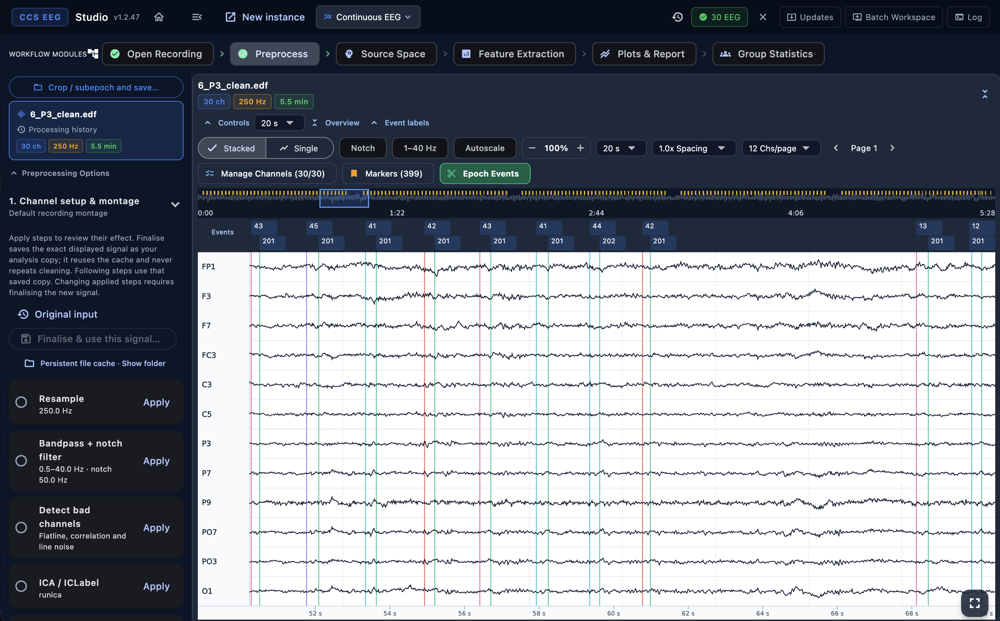
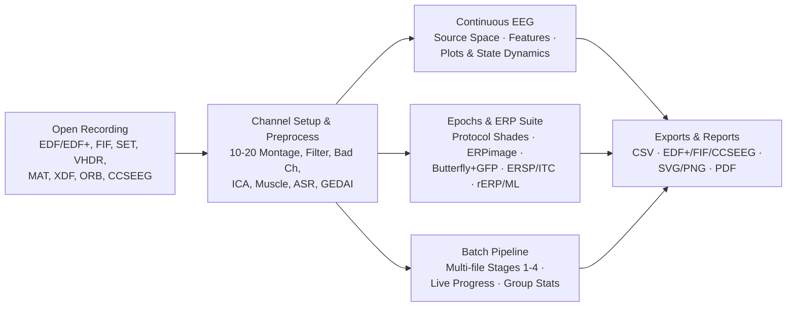
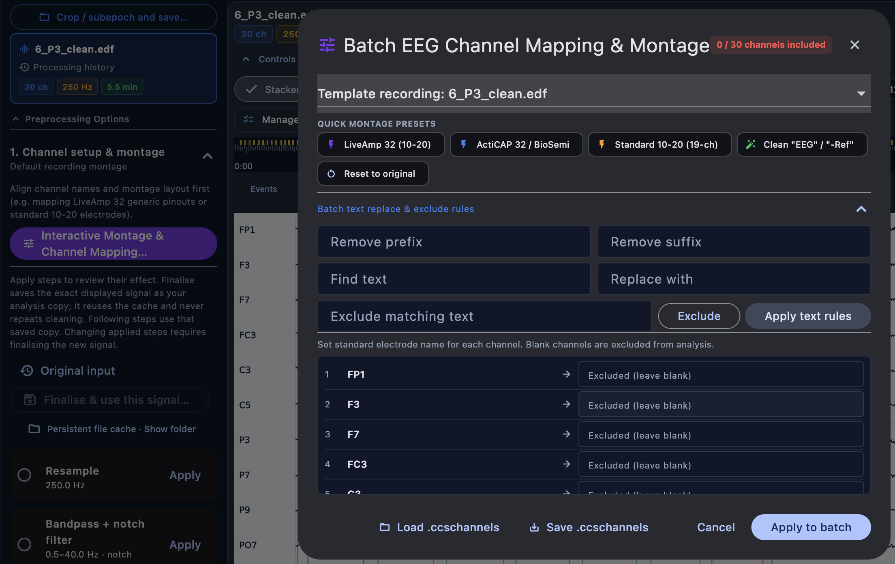
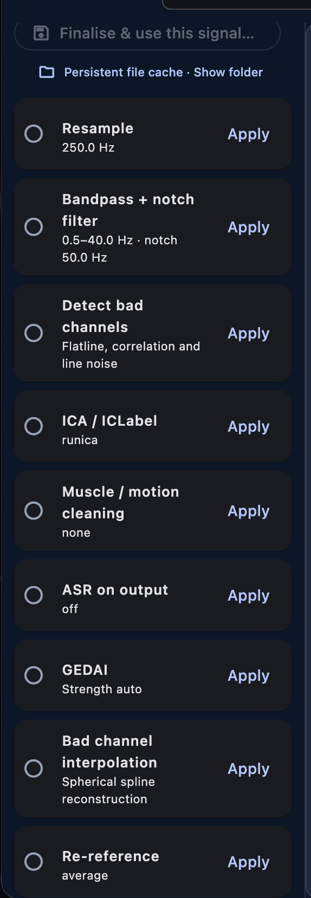
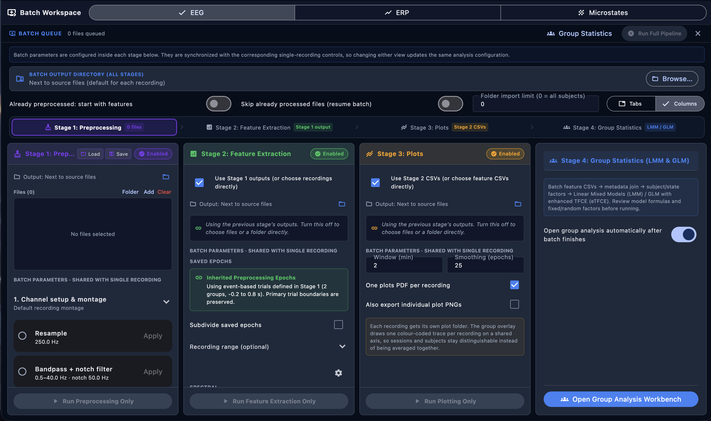
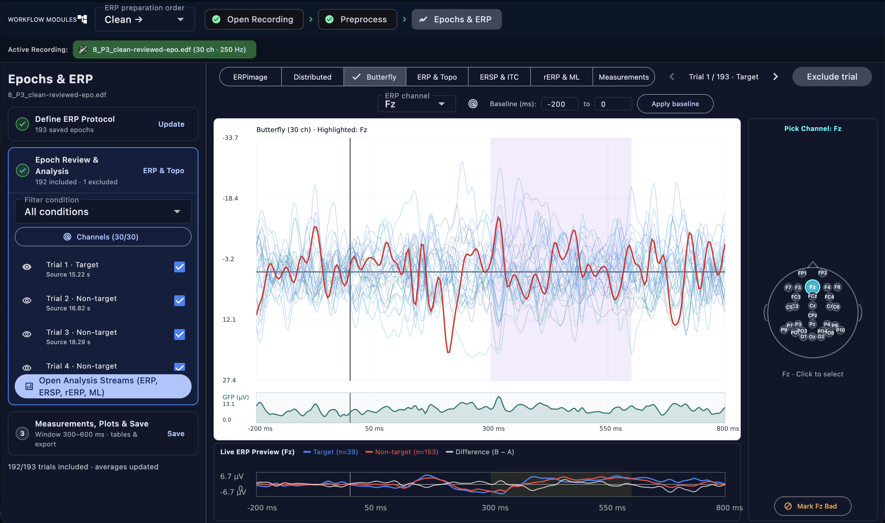
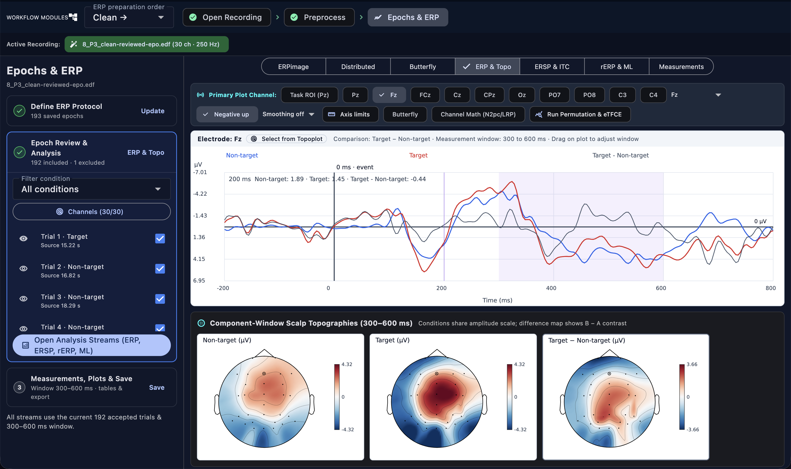
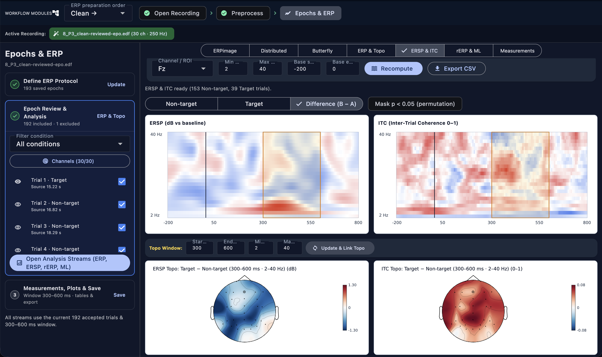
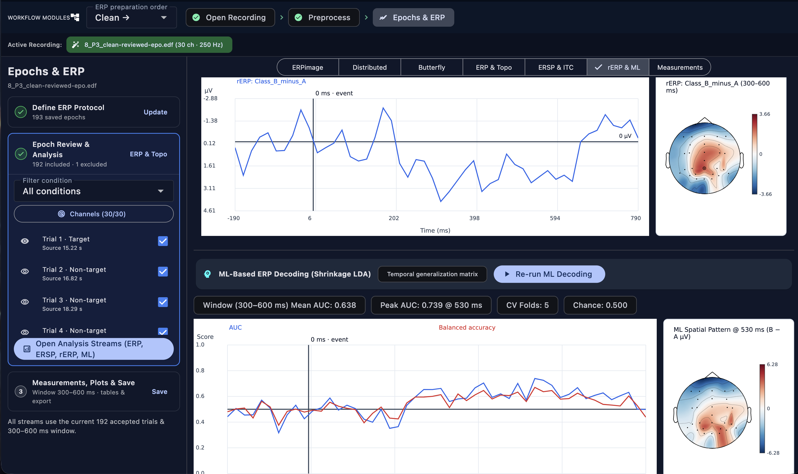
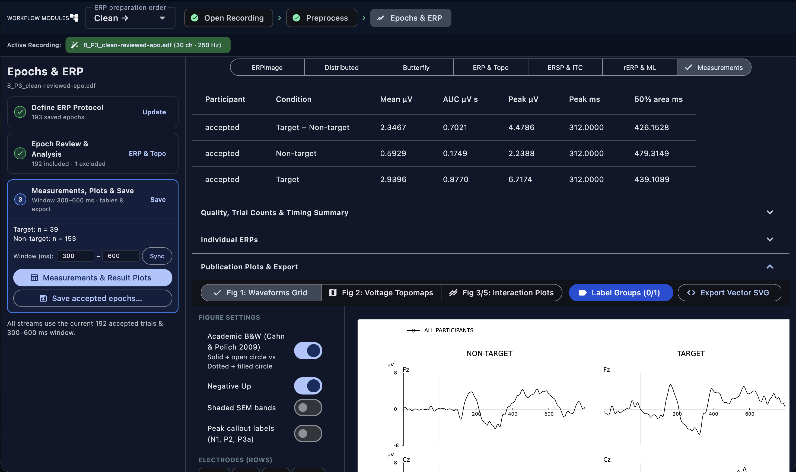

<p align="center">
  
</p>

<h1 align="center">CCS EEG Studio</h1>

<p align="center">
  <b>Native-speed EEG preprocessing, feature extraction, state dynamics, ERP/ERSP/rERP/ML analysis, and reporting</b>
</p>

<p align="center">
  A Research & Engineering Collaboration of<br>
  <b>Centre for Consciousness Studies (CCS)</b>, Department of Neurophysiology,<br>
  <b>National Institute of Mental Health and Neurosciences (NIMHANS)</b>, Bengaluru, India &nbsp;🤝&nbsp;
  <a href="https://axxonet.com/"><b>Axxonet</b></a>
</p>

<p align="center">
  <a href="https://github.com/CCS-NIMHANS/CCS_EEGStudio/releases/latest"></a>
  <a href="https://github.com/CCS-NIMHANS/CCS_EEGStudio/actions/workflows/build.yml"></a>
  <a href="https://github.com/CCS-NIMHANS/CCS_EEGStudio/releases"></a>
  <a href="https://joss.theoj.org/"></a>
</p>

<p align="center">
  <b>Current version: 1.2.49</b> ·
  <a href="docs/wiki/Home.md"><b>Visual Wiki</b></a> ·
  <a href="CHANGELOG.md"><b>Release Notes</b></a> ·
  <a href="paper/paper.md"><b>JOSS Paper</b></a> ·
  <a href="https://github.com/CCS-NIMHANS/CCS_EEGStudio/issues"><b>Report Issue</b></a>
</p>

---

## 📥 Quick Download

| Platform | Package | Direct Download |
| :--- | :--- | :--- |
| **macOS** | Apple Silicon ZIP (macOS 12+) | [CCSEEGStudio-macos.zip](https://github.com/CCS-NIMHANS/CCS_EEGStudio/releases/latest/download/CCSEEGStudio-macos.zip) |
| **Windows** | 64-bit Installer (Windows 10/11) | [CCSEEGStudio-Installer.exe](https://github.com/CCS-NIMHANS/CCS_EEGStudio/releases/latest/download/CCSEEGStudio-Installer.exe) |
| **Linux (Debian / Ubuntu)** | amd64 `.deb` | [CCSEEGStudio-linux-amd64.deb](https://github.com/CCS-NIMHANS/CCS_EEGStudio/releases/latest/download/CCSEEGStudio-linux-amd64.deb) |
| **Linux (RHEL / AlmaLinux)** | x86_64 `.rpm` | [CCSEEGStudio-linux-x86_64.rpm](https://github.com/CCS-NIMHANS/CCS_EEGStudio/releases/latest/download/CCSEEGStudio-linux-x86_64.rpm) |

> 📦 Checksums (`SHA256SUMS.txt`) and all assets are on the **[GitHub Releases Page](https://github.com/CCS-NIMHANS/CCS_EEGStudio/releases/latest)**. Use **Updates** in the app header for in-app upgrades.

<details>
<summary><b>🍏 macOS Gatekeeper Setup & 🐧 Multi-User Linux Server Install</b></summary>

**macOS (first launch):**
```sh
xattr -rd com.apple.quarantine ~/Downloads/CCS\ EEG\ Studio.app
mv ~/Downloads/CCS\ EEG\ Studio.app /Applications/
```

**Linux multi-user server (AlmaLinux / RHEL / Ubuntu / Debian):**
```bash
curl -fsSL https://raw.githubusercontent.com/CCS-NIMHANS/CCS_EEGStudio/main/scripts/install_linux.sh | sudo bash
# Update later:
sudo update-ccs-eeg-studio
```
Non-admin users can install/update per-user without `sudo` (see [Server Controls](docs/server_and_plot_controls.md)).

</details>

<p align="center">
  
</p>

---

## ✨ What's New in v1.2.49

- **Timestamp-Synced Video/Audio & Neural Speech Tracking:** Floating **Video / Audio** panel (`media_kit`) syncs multiple video or WAV audio files to EEG via metadata/filename timestamps, extracts audio waveforms & speech envelopes, and runs Rust **TRF encoding + backward stimulus-reconstruction decoding**.
- **IAF, Frequency Sliding & XPIKAN Source Localization:** Added `IAF_Hz`, `IndTheta_PSD`, `IndAlpha_PSD`, `Alpha/Theta_FreqSliding_Hz`, and **XPIKAN** (*Extended Physics-Informed Kolmogorov–Arnold Network*) source localization.
- **Reliability & Workflow Fixes:** Upgraded bad-channel detection + manual batch/single rejection table, fixed Windows preprocessing stage caching, added `Elapsed (s) | HH:MM:SS | Clock | Epoch` X-axis modes, interactive crop bad-segment marking, asymmetric EDF scaling (fixing DC-offset distortion), per-epoch microstate sequence CSVs, and publication parameter/methodology reports.

See [CHANGELOG.md](CHANGELOG.md) for full release history.

---

## 🧭 Visual Workflow & Wiki

**CCS EEG Studio** pairs a **Flutter** desktop UI with a **native Rust engine (`ccs-eeg-engine`)**—requiring no Python or MATLAB for core EEG workflows.



### 📖 Visual Wiki Guides

| Guide | Topics Covered |
| :--- | :--- |
| [**Wiki Home**](docs/wiki/Home.md) | Architecture overview, supported formats, and end-to-end workflow map |
| [**1. Continuous & Preprocessing**](docs/wiki/Continuous-and-Preprocessing.md) | Rust XDF import, unlocated channel guard, montage presets, ICA/ASR/GEDAI preview |
| [**2. Features & State Dynamics**](docs/wiki/Features-and-State-Dynamics.md) | PSD/FOOOF/IRASA, DFA/fE:I, connectivity, microstates, all-states feature mapping |
| [**3. Epochs & ERP Suite**](docs/wiki/Epochs-and-ERP-Suite.md) | Protocol shades, ERPimage, Butterfly + separate GFP, ERP & Topo, ERSP/ITC, rERP & ML |
| [**4. Batch & Group Statistics**](docs/wiki/Batch-and-Group-Statistics.md) | Multi-file Stage 1–4 pipeline, step toggles, progress monitor, grand-average review, shortcuts |
| [**5. Synced Video/Audio & Speech Tracking**](docs/wiki/Video-Audio-and-Speech-Tracking.md) | Timestamp-synced multi-video/audio, speech envelope, Neural Speech Tracking (TRF & Decoder) |

---

## 🖥️ Screenshots

| Main Workspace | Channel Setup & Montage |
| :---: | :---: |
|  |  |

| Preprocessing Options | Feature Extraction & State Dynamics |
| :---: | :---: |
|  |  |

| Batch Analysis Pipeline | Live Batch Progress |
| :---: | :---: |
|  |  |

| ERPimage (Grouped Events + Topo) | Butterfly Plot + Separate GFP |
| :---: | :---: |
|  |  |

| ERP Waveforms & Topographies | ERSP & ITC Linked Topos |
| :---: | :---: |
|  |  |

| rERP & ML Decoding | ERP Measurements & Export |
| :---: | :---: |
|  |  |

---

## 🚀 Building & Testing Locally

**Prerequisites:** Flutter SDK (`3.x+`) and Rust toolchain (`cargo` / `rustc`).

```bash
# 1. Build the native Rust engine
cargo build --release --manifest-path bridge/Cargo.toml

# 2. Run Flutter desktop app in development mode
flutter pub get
flutter run -d macos   # or windows / linux

# 3. Run automated tests
cargo test --manifest-path bridge/Cargo.toml
flutter analyze
flutter test
```

<details>
<summary><b>📦 Packaging Production Releases (macOS / Windows / Linux)</b></summary>

```bash
./scripts/build_macos.sh                           # macOS (.app bundle)
iscc windows\installer.iss                         # Windows (Inno Setup .exe)
./scripts/build_linux_deb.sh                       # Debian / Ubuntu (.deb)
./scripts/build_linux_rpm.sh                       # RHEL / AlmaLinux (.rpm)
```

</details>

---

## 🤝 Acknowledgments, Related Projects & Citation

- **Research Collaboration:** **Centre for Consciousness Studies (CCS)**, Dept. of Neurophysiology, **NIMHANS**, Bengaluru & **[Axxonet](https://axxonet.com/)**.
- **Related Repositories:** [CCS Sleep Studio](https://github.com/CCS-NIMHANS/CCS_SleepStudio) · [CCS Mobile Studio](https://github.com/CCS-NIMHANS/CCS_MobileStudio) · [CCS PPG Studio](https://github.com/CCS-NIMHANS/CCS_PPGStudio)
- **Scientific Validation:** [Method Validation & References](docs/methods_and_validation.md) · [JOSS Paper](paper/paper.md)
- **License:** [MIT License](LICENSE) © 2026 Dr. Arun Sasidharan, Centre for Consciousness Studies, NIMHANS.

```bibtex
@article{Sasidharan2026CCSEEGStudio,
  author    = {Arun Sasidharan},
  title     = {{CCS EEG Studio}: A cross-platform desktop application for cognitive and clinical neurophysiology research, artifact cleaning, and quantitative electroencephalography},
  journal   = {Journal of Open Source Software},
  year      = {2026},
  publisher = {The Open Journal},
  url       = {https://github.com/CCS-NIMHANS/CCS_EEGStudio}
}
```
