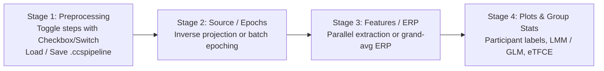

# 4. Batch Pipeline & Group Statistics

[← Epochs & ERP Suite](Epochs-and-ERP-Suite.md) · [Wiki Home](Home.md)

---

## Multi-File Batch Pipeline

| Batch Pipeline Configuration | Live Batch Progress & File Status |
| :---: | :---: |
|  |  |

---

## Key Batch & Server Capabilities

- **Direct Step Toggles:** In **Stage 1: Preprocessing**, each step card (`Resample`, `Bandpass + notch`, `Detect bad channels`, `ICA`, `Muscle`, `ASR`, `GEDAI`, `Interpolate`, `Re-reference`) has a direct **Checkbox + Switch** (`Included` / `Skipped`) on its header.
- **Channel Mapping Across Batches:** Use **Interactive Montage & Channel Mapping** to apply channel renames, 10–20 presets, or non-EEG exclusions across all queued files (`.ccschannels`).
- **Interactive ERP Batch Review:** Inspect individual participant ERPs alongside equal-participant Grand Averages (`±1 SEM`), assign cohort/group labels, and run group-level statistics.
- **Multi-User Linux Server Support:** Install system-wide via `scripts/install_linux.sh` or per-user without `sudo` (see [Server & Plot Controls](../server_and_plot_controls.md)).

---

## Keyboard Shortcuts

| Shortcut | Action |
| :--- | :--- |
| `Space` | Play / Pause continuous EEG scrolling |
| `←` / `→` | Step backward / forward in time window |
| `↑` / `↓` | Increase / decrease EEG amplitude scale |
| `Ctrl/Cmd + O` | Open recording |
| `Ctrl/Cmd + S` | Save / export current output |
