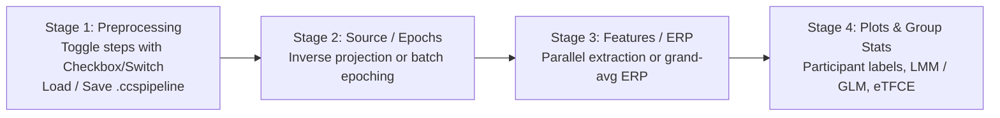
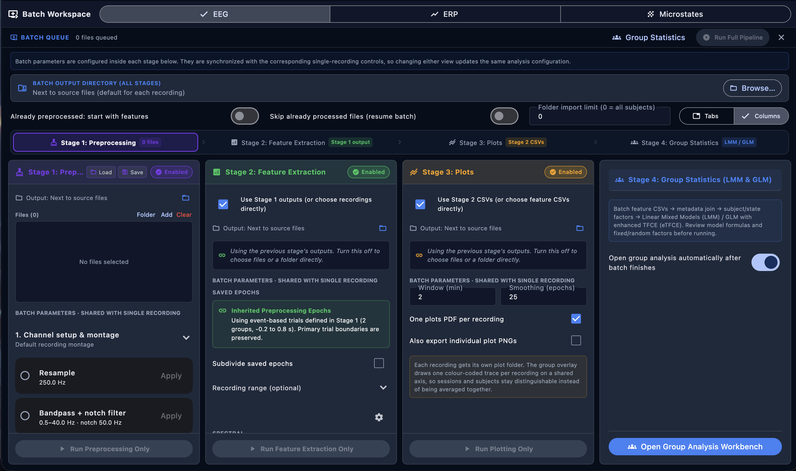
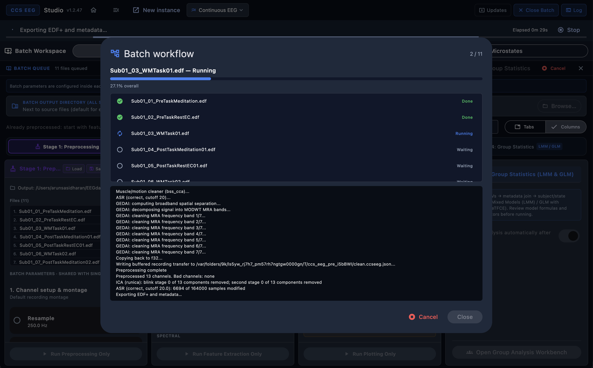

# 4. Batch Pipeline & Group Statistics

[← Epochs & ERP Suite](Epochs-and-ERP-Suite.md) · [Wiki Home](Home.md)

---

## Multi-File Batch Pipeline

| Batch Pipeline Configuration | Live Batch Progress & File Status |
| :---: | :---: |
|  |  |

---

## Key Batch & Server Capabilities

- **Direct Step Toggles:** In **Stage 1: Preprocessing**, each step card (`Resample`, `Bandpass + notch`, `Detect bad channels`, `ICA`, `Muscle`, `ASR`, `GEDAI`, `Interpolate`, `Re-reference`) has a direct **Checkbox + Switch** (`Included` / `Skipped`) on its header.
- **Channel Numbers, Mixed Counts & Unified Batch CSVs:** **Interactive Montage & Channel Mapping** automatically detects mixed channel counts across queued files, supports positional/numeric channel labels (`1`, `Ch1`, `EEG 1`), and harmonizes varying channel/feature column headers cleanly in `Batch_features.csv`.
- **Standalone Group Statistics (LMM / GLM):** Runs natively via `ccs-eeg-engine` with zero external Python requirements, supporting composable factor grouping (`Factors & Groups…`), custom factor-level ordering, **Contrast scope** (`All factors` vs focused factor), and **Multiple ERP differences** (`+ Add difference`).
- **Publication Parameter Logs & Methodology Reports:** Every single-file and batch run writes `preprocessing_parameters.json`, `feature_parameters.json`, `analysis_parameters_log.md`, and `batch_methodology_and_results_report.md` directly into the output directory.
- **Interactive ERP Batch Review & Statistics:** Use the **Unbiased Grand Average Localizer** and **Factor & Grouping Designer** (`Groups.xlsx` / BIDS / interactive filename cropper), then run **Mixed-Design ANOVA / Permutation GLM & LMM** with live factor plot configuration.
- **Multi-User Linux Server Support:** Install system-wide via `scripts/install_linux.sh` or per-user without `sudo` (see [Server & Plot Controls](../server_and_plot_controls.md)).

---

## Method References

| Statistical Method / Plot | Reference |
| :--- | :--- |
| **Unbiased Grand Average Collapsed Localizer** | Luck & Gaspelin (2017), *Psychophysiology* 54(1):146–157, [doi:10.1111/psyp.12639](https://doi.org/10.1111/psyp.12639) |
| **Split-Plot Mixed-Design ANOVA & Exchangeable Permutation** | Anderson & Braak (2003), *J. Stat. Comput. Simul.* 73(2):85–113; Winkler et al. (2014), *NeuroImage* 92:381–397 |
| **BH-FDR & e-TFCE Multi-Channel Correction** | Benjamini & Hochberg (1995), *J. R. Stat. Soc. B* 57(1):289–300; Mensen & Khatami (2013), [doi:10.1016/j.neuroimage.2012.10.027](https://doi.org/10.1016/j.neuroimage.2012.10.027) |

---

## Keyboard Shortcuts

| Shortcut | Action |
| :--- | :--- |
| `Space` | Play / Pause continuous EEG scrolling |
| `←` / `→` | Step backward / forward in time window |
| `↑` / `↓` | Increase / decrease EEG amplitude scale |
| `Ctrl/Cmd + O` | Open recording |
| `Ctrl/Cmd + S` | Save / export current output |
