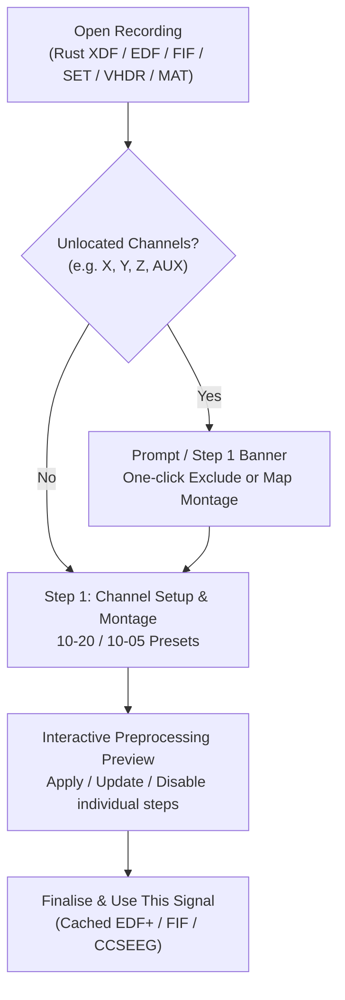
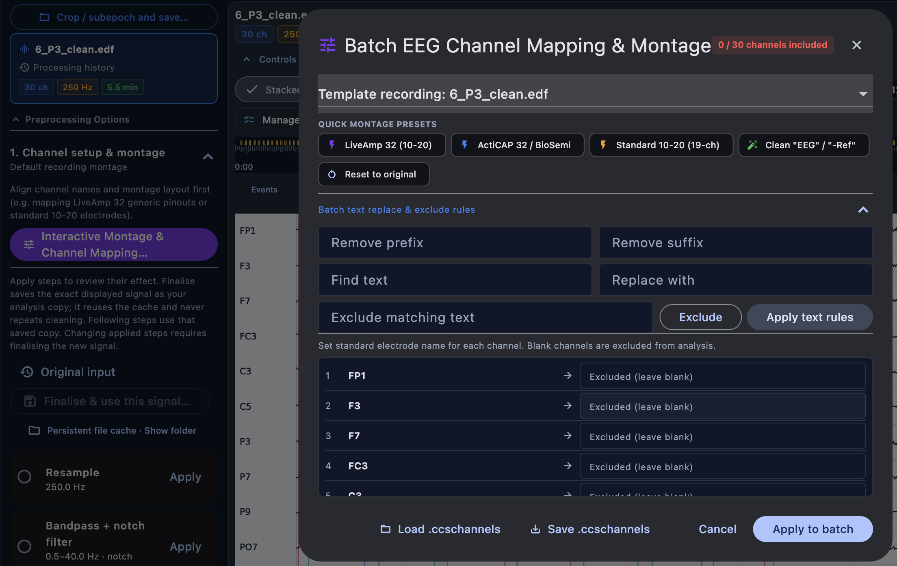

# 1. Recording Import, Channel Setup & Preprocessing

[← Wiki Home](Home.md) · [Next: Features & State Dynamics →](Features-and-State-Dynamics.md)

---

## Visual Flow

---

## Main Workspace & Channel Selection

| Main Continuous EEG Workspace | Channel Selection & Montage Mapping |
| :---: | :---: |
|  |  |

- **Fast Rust XDF Import:** `.xdf` files load via the native Rust engine (`inspect_xdf`) and automatically snap minor LSL clock drift (within `0.5%`) to the exact nominal rate (e.g. `250.0 Hz`).
- **Source-Space ROI Viewer Labels:** When viewing reconstructed DK68 source recordings (`src-...`), the waveform viewer displays ROI counts (`68 ROIs`), `ROIs/page` pagination presets (including `12 ROIs/page`), and `Manage ROIs`.
- **Unlocated Channel Guard:** Channels lacking 10–20/10–05 scalp coordinates (such as motion channels `X`, `Y`, `Z` or auxiliary channels) are flagged immediately with a one-click removal button so spatial filters (GEDAI, ICA, interpolation) never run on non-scalp channels (while keeping `-lh`/`-rh` source ROIs intact).

---

## Interactive Preprocessing Steps

| Step | Purpose | Key Notes |
| :--- | :--- | :--- |
| **Resample** | Uniform target sampling rate | Preserves event marker alignment |
| **Bandpass + Notch** | High-pass, low-pass & line-noise notch | Leave any field blank (`0.0`) to disable that filter |
| **Detect Bad Channels** | Flatline, correlation & line-noise check | Feeds bad-channel list to interpolation |
| **ICA / ICLabel** | Automated ocular/muscle component rejection | Respects epoch boundaries when run on epoched data |
| **Muscle / Motion** | CCA / wavelet muscle artifact reduction | Optional burst & EMG cleaning |
| **ASR** | Artifact Subspace Reconstruction | Continuous-data burst repair |
| **GEDAI** | Spatial-reference leadfield artifact cleaning | Uses built-in 10–05 leadfield when channels are mapped |
| **Interpolate (Surround-Aware)** | Spherical spline repair with 3D surround-support check | Configurable `min neighbors`, `max angle`, `max gap`; safely skips unsupported edge channels |
| **Re-reference** | Average (default) / Linked-ear / Custom ref | Default `Standard (5)` preset applies Filter, Bad Ch, GEDAI, Interpolate, Reference; also offers `Full (ICA+ASR)` |

> **Tip:** Click **Apply selected & finalise…** to lock the exact displayed waveform for downstream **Source Space**, **Feature Extraction**, or **Epochs & ERP** without re-running cleaning. The **Workflow Modules** strip retains green completion checkmarks across module switches, and parameter logs (`preprocessing_parameters.json`, `analysis_parameters_log.md`) are saved automatically alongside finalized outputs.

---

## Method References

| Step / Model | Reference |
| :--- | :--- |
| **Bad Channel Detection (PREP-style)** | Bigdely-Shamlo et al. (2015), *Front. Neuroinform.* 9:16, [doi:10.3389/fninf.2015.00016](https://doi.org/10.3389/fninf.2015.00016) |
| **Spherical Spline Interpolation** | Perrin et al. (1989), *Electroencephalogr. Clin. Neurophysiol.* 72:184–187, [doi:10.1016/0013-4694(89)90180-6](https://doi.org/10.1016/0013-4694(89)90180-6) |
| **Infomax ICA (`runica`)** | Bell & Sejnowski (1995), [doi:10.1162/neco.1995.7.6.1129](https://doi.org/10.1162/neco.1995.7.6.1129); Delorme & Makeig (2004), [doi:10.1016/j.jneumeth.2003.10.009](https://doi.org/10.1016/j.jneumeth.2003.10.009) |
| **Picard** | Ablin, Cardoso & Gramfort (2018), *IEEE Trans. Signal Process.* 66(15), [doi:10.1109/TSP.2018.2844203](https://doi.org/10.1109/TSP.2018.2844203) |
| **ICLabel** | Pion-Tonachini et al. (2019), *NeuroImage* 198:181–197, [doi:10.1016/j.neuroimage.2019.05.026](https://doi.org/10.1016/j.neuroimage.2019.05.026) |
| **ASR & Riemannian ASR** | Mullen et al. (2015), [doi:10.1109/TBME.2015.2481482](https://doi.org/10.1109/TBME.2015.2481482); Chang et al. (2020), [doi:10.1109/TBME.2019.2930186](https://doi.org/10.1109/TBME.2019.2930186); Blum et al. (2019), [doi:10.3389/fnhum.2019.00141](https://doi.org/10.3389/fnhum.2019.00141) |
| **BSS-CCA / iCanClean / wICA** | De Clercq et al. (2006), [doi:10.1109/TBME.2006.879459](https://doi.org/10.1109/TBME.2006.879459); Downey & Ferris (2022), [arXiv:2201.11798](https://arxiv.org/abs/2201.11798); Gabard-Durnam et al. (2018), [doi:10.3389/fnins.2018.00097](https://doi.org/10.3389/fnins.2018.00097) |
| **GEDAI** | Congedo et al. (2024), [GEDAI](https://github.com/Marco-Congedo/Gedai) |
| **MNE / dSPM / sLORETA / LCMV** | Hämäläinen & Ilmoniemi (1994); Dale et al. (2000); Pascual-Marqui (2002); Van Veen et al. (1997) |
| **XPIKAN (3-Shell Physics-Informed KAN)** | Fokas, Aghaei & Hashemzadeh (2026), [XPIKAN Forward EEG](https://github.com/alirezaafzalaghaei/xpikan-forward-eeg); Liu et al. (2024), [arXiv:2404.19756](https://arxiv.org/abs/2404.19756); Jagtap & Karniadakis (2020), [doi:10.4208/cicp.OA-2020-0164](https://doi.org/10.4208/cicp.OA-2020-0164) |
