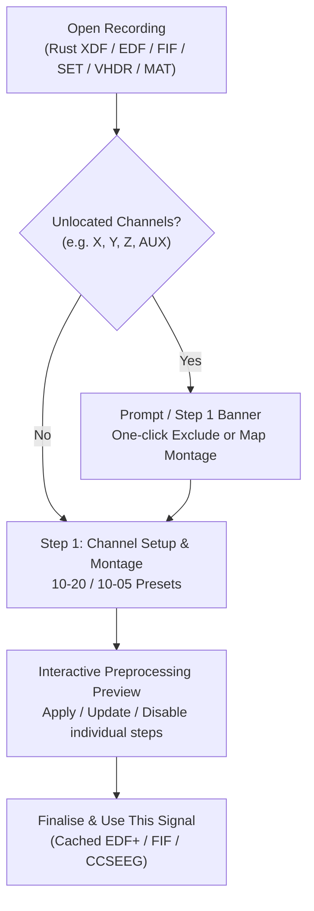
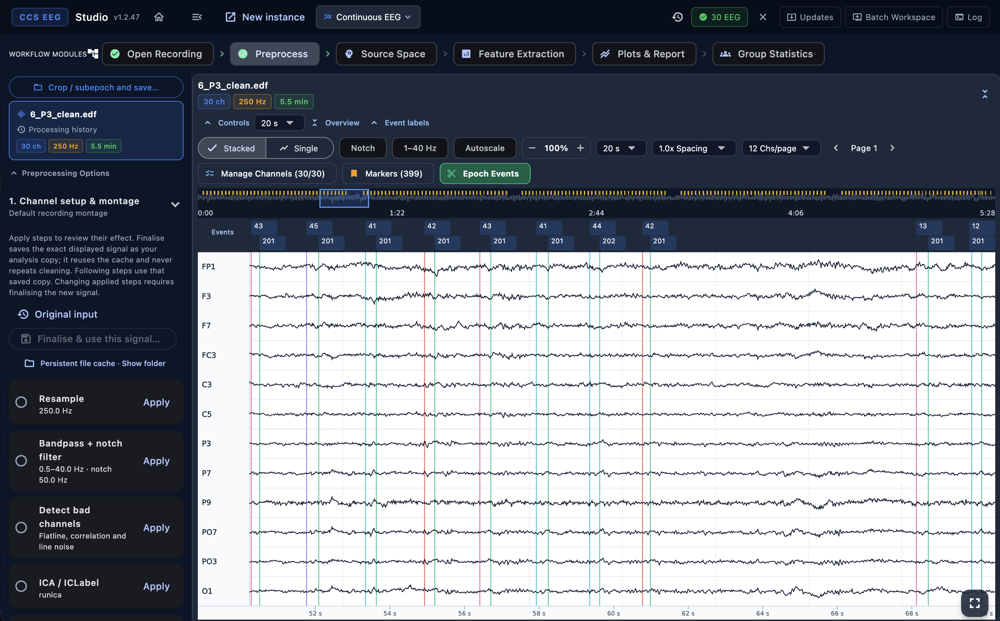
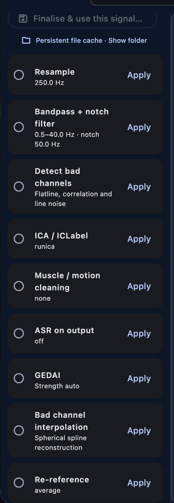

# 1. Recording Import, Channel Setup & Preprocessing

[← Wiki Home](Home.md) · [Next: Features & State Dynamics →](Features-and-State-Dynamics.md)

---

## Visual Flow

---

## Main Workspace & Channel Selection

| Main Continuous EEG Workspace | Channel Selection & Montage Mapping |
| :---: | :---: |
|  |  |

- **Fast Rust XDF Import:** `.xdf` files load via the native Rust engine (`inspect_xdf`) and automatically snap minor LSL clock drift (within `0.5%`) to the exact nominal rate (e.g. `250.0 Hz`).
- **Unlocated Channel Guard:** Channels lacking 10–20/10–05 scalp coordinates (such as motion channels `X`, `Y`, `Z` or auxiliary channels) are flagged immediately with a one-click removal button so spatial filters (GEDAI, ICA, interpolation) never run on non-scalp channels.

---

## Interactive Preprocessing Steps

| Step | Purpose | Key Notes |
| :--- | :--- | :--- |
| **Resample** | Uniform target sampling rate | Preserves event marker alignment |
| **Bandpass + Notch** | High-pass, low-pass & line-noise notch | Leave any field blank (`0.0`) to disable that filter |
| **Detect Bad Channels** | Flatline, correlation & line-noise check | Feeds bad-channel list to interpolation |
| **ICA / ICLabel** | Automated ocular/muscle component rejection | Respects epoch boundaries when run on epoched data |
| **Muscle / Motion** | CCA / wavelet muscle artifact reduction | Optional burst & EMG cleaning |
| **ASR** | Artifact Subspace Reconstruction | Continuous-data burst repair |
| **GEDAI** | Spatial-reference leadfield artifact cleaning | Uses built-in 10–05 leadfield when channels are mapped |
| **Interpolate & Re-reference** | Spherical spline + Average / Linked-ear / Custom ref | Finalises clean analysis copy to persistent cache |

> **Tip:** Click **Finalise & use this signal** to lock the exact displayed waveform for downstream **Source Space**, **Feature Extraction**, or **Epochs & ERP** without re-running cleaning.
