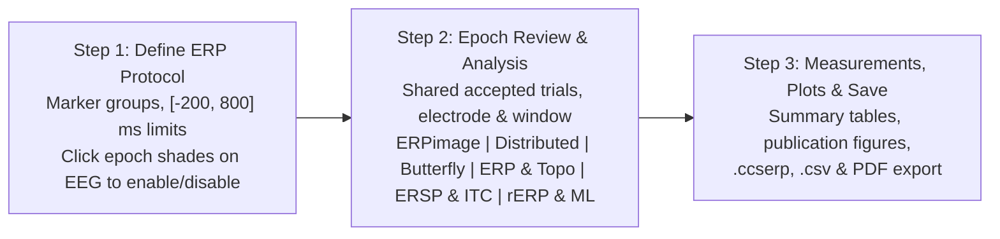
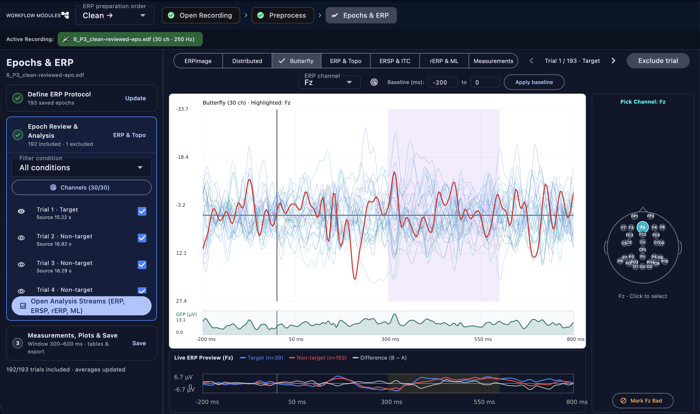
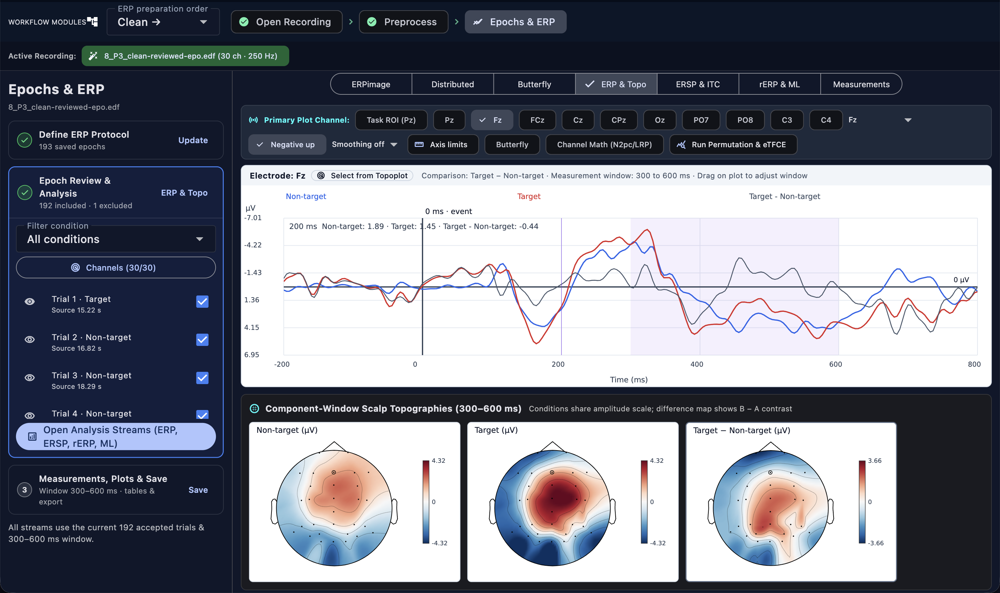

# 3. Coordinated Epochs & ERP Analysis Suite

[← Features & State Dynamics](Features-and-State-Dynamics.md) · [Wiki Home](Home.md) · [Next: Batch & Group Statistics →](Batch-and-Group-Statistics.md)

---

## 3-Step Visual Workflow

Everything in **Step 2** shares **one accepted-trial set**, **one active electrode** (selectable from dropdown or 2D scalp topoplot), and **one always-visible measurement window** (`Start–End ms`) with cross-platform Windows/macOS layout and short cache path handling.

---

## Interactive Review & Analysis Views

| ERPimage (Grouped Events + Linked Topo) | Butterfly Plot + Separate GFP Strip |
| :---: | :---: |
|  |  |
| • EEGLAB-style RdBu diverging heatmap (`Smooth: 1/3/5/10`) • Inline **Group** selector (`Both` or single condition) + colored condition strips & dividers • Click/drag rows to reject or reinstate trials; linked **Topo ms** window | • Highlights **only the active electrode** in red across all channels • Dedicated lower **GFP (µV)** strip with its own Y-axis • Time axis aligned vertically with `Live ERP Preview` & right-side Topo channel picker |

| ERP Waveforms & Scalp Topographies | ERSP & ITC (Time–Frequency + Linked Topos) |
| :---: | :---: |
|  |  |
| • Condition waveforms (`A`, `B`, `B − A`) + interactive drag window • Within-subject permutation & **eTFCE** significance masks • **Channel Algebra** (`N2pc`, `LRP`, `Custom Ch A − Ch B`) | • Parallel Morlet wavelet **ERSP (dB)** & **ITC (0–1)** with permutation masking • Inline **Topo Window** (`ms` & `Hz`) synced with ERSP & ITC scalp topographies |

| rERP Overlap Correction & ML Decoding | Measurements, Publication Plots & Export |
| :---: | :---: |
|  |  |
| • Guided **rERP** GLM overlap-correction overlaid against Conventional ERP + Beta topo • **Shrinkage LDA** time-resolved decoding, Peak AUC/latency & spatial pattern topoplot | • Component latency/amplitude tables (`Mean`, `Peak`, `Area`, `50% Fractional Area`) • Publication-ready multi-panel exports (`.csv`, `.ccserp`, `.svg`/`.png`, `.pdf`) |

---

## Method References

| Component / Test | Reference |
| :--- | :--- |
| **ERP Waveform, Peak/Area & Trial Rejection** | Luck (2014), *An Introduction to the Event-Related Potential Technique*, MIT Press |
| **ERPimage, ERSP & Inter-Trial Coherence** | Delorme & Makeig (2004), *J. Neurosci. Methods* 134:9–21, [doi:10.1016/j.jneumeth.2003.10.009](https://doi.org/10.1016/j.jneumeth.2003.10.009) |
| **Overlap-Corrected Regression ERP (`rERP`)** | Ehinger & Dimigen (2019), *PeerJ* 7:e7838, [doi:10.7717/peerj.7838](https://doi.org/10.7717/peerj.7838) |
| **Threshold-Free Cluster Enhancement (`e-TFCE`)** | Smith & Nichols (2009), [doi:10.1016/j.neuroimage.2008.03.061](https://doi.org/10.1016/j.neuroimage.2008.03.061); Mensen & Khatami (2013), [doi:10.1016/j.neuroimage.2012.10.027](https://doi.org/10.1016/j.neuroimage.2012.10.027) |
| **Cluster Permutation & Shrinkage LDA** | Maris & Oostenveld (2007), [doi:10.1016/j.jneumeth.2007.03.024](https://doi.org/10.1016/j.jneumeth.2007.03.024); Blankertz et al. (2011), *NeuroImage* 56(2):814–825 |
