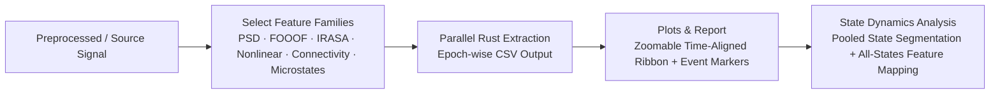

# 2. Feature Extraction, Plots & State Dynamics

[← Preprocessing](Continuous-and-Preprocessing.md) · [Wiki Home](Home.md) · [Next: Epochs & ERP Suite →](Epochs-and-ERP-Suite.md)

---

## Visual Flow

---

## Feature Extraction & Interactive Plots

| Feature Families | Time-Aligned Feature Plots & State Dynamics |
| :---: | :---: |
|  |  |

| Family | Computed Metrics |
| :--- | :--- |
| **Spectral** | Bandpower & relative power (Welch PSD), **FOOOF** (aperiodic offset/exponent + periodic peaks), **IRASA** (fractal vs oscillatory separation) |
| **Nonlinear & Complexity** | **DFA**, **fE:I** (functional E/I ratio), Sample/Permutation Entropy, Higuchi FD, **ACW** (autocorrelation window) |
| **Connectivity** | **COH**, **PLV**, **ciPLV**, **PLI**, **wPLI**, **MIC / MIM**, **Granger Causality (GC / GC-TR)**, graph efficiency & modularity |
| **Microstates** | K-means / modified K-means maps, GEV, duration, occurrence, coverage, transition matrix & **Microstate Syntax** entropy |

---

## State Dynamics Analysis

- **Integrated Timeline:** State segments and multi-scale boundaries overlay directly on the zoomable feature plot; click any state segment to jump to its profile.
- **All-States Feature Mapping Comparison:** Pooled states (`State A`, `State B`, `State C`, …) are displayed side-by-side on one page with shared metric rows, significant-vs-rest dots, and an `ACTIVE` highlight on the currently selected state. Toggle **Compare All States** to switch between side-by-side comparison and single-state zoom.
