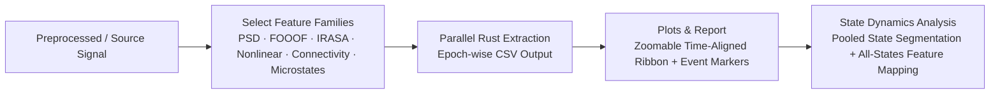
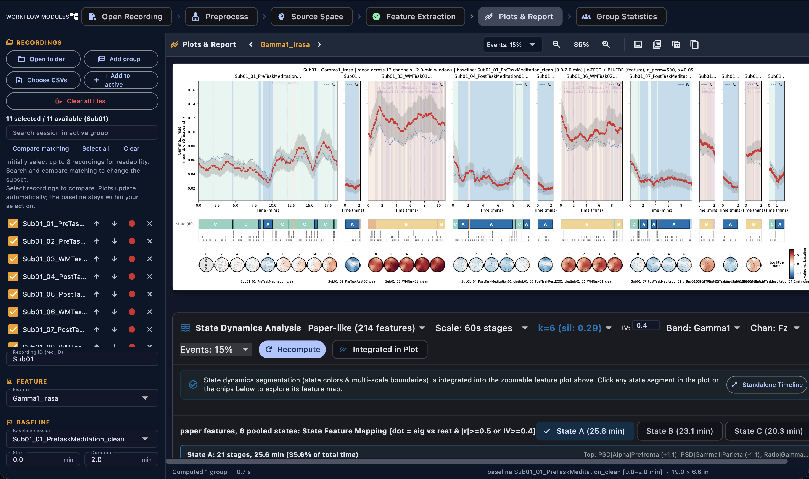

# 2. Feature Extraction, Plots & State Dynamics

[← Preprocessing](Continuous-and-Preprocessing.md) · [Wiki Home](Home.md) · [Next: Epochs & ERP Suite →](Epochs-and-ERP-Suite.md)

---

## Visual Flow

---

## Feature Extraction & Interactive Plots

| Feature Families | Time-Aligned Feature Plots & State Dynamics |
| :---: | :---: |
|  |  |

| Family | Computed Metrics |
| :--- | :--- |
| **Spectral & IAF** | Bandpower & relative power (Welch / Multitaper PSD), toggleable **Individual Alpha** (`IAF_Hz`, `IndAlpha_PSD`, `IndTheta_PSD`, `Theta/Alpha_FreqSliding_Hz` with configurable `IAF search range`), **Spectral Ratios** (8 band ratios: `Ratio_DeltaTheta`, `Ratio_DeltaAlpha`, `Ratio_ThetaAlpha`, `Ratio_ThetaBeta`, `Ratio_AlphaBeta`, `Ratio_SlowFast`, `Ratio_DAR`, `Ratio_TBR`), **FOOOF**, **IRASA** |
| **Nonlinear & Complexity** | **DFA**, **fE:I** (functional E/I ratio), Sample/Permutation Entropy, Higuchi FD, Petrosian FD, LZC, **ACW** (autocorrelation window) |
| **Connectivity** | **COH**, **PLV**, **ciPLV**, **PLI**, **wPLI**, **MIC / MIM**, **Granger Causality (GC / GC-TR)**, graph efficiency & modularity |
| **Microstates & Syntax** | Modified k-means maps, GEV, duration, occurrence, coverage, transition matrix, **Microstate Syntax** entropy & dedicated per-file/epoch `<stem>_microstate_sequence.csv` |

---

## Source-Space TopoStats & State Dynamics Analysis

- **Unified Source & Scalp Pipeline:** Source-level feature CSVs (`bankssts-lh`, `...` DK68 ROIs) run through the identical **TopoStats** and **State Dynamics** statistical pipeline as scalp EEG (time-series ribbon, significance clusters, state strips, multi-scale rasters, PDF report, and click-to-inspect zoom), replacing only the bottom scalp topoplots with **3-axis Glass Brains** (Sagittal, Coronal, Axial).
- **Integrated Timeline:** State segments and multi-scale boundaries overlay directly on the zoomable feature plot; click any state segment to jump to its profile.
- **Synced Audio & Envelope Ribbon:** When Video/Audio files are loaded, click **Audio & Envelope** in the Plots & Report toolbar to view the synced audio waveform and speech envelope aligned with the feature time-series cursor.
- **All-States Feature Mapping Comparison:** Pooled states (`State A`, `State B`, `State C`, …) are displayed side-by-side on one page with shared metric rows, significant-vs-rest dots, and an `ACTIVE` highlight on the currently selected state. Toggle **Compare All States** to switch between side-by-side comparison and single-state zoom.

---

## Method References

| Metric Family | Reference |
| :--- | :--- |
| **Welch & Multitaper PSD** | Welch (1967), [doi:10.1109/TAU.1967.1161901](https://doi.org/10.1109/TAU.1967.1161901); Thomson (1982), [doi:10.1109/PROC.1982.12433](https://doi.org/10.1109/PROC.1982.12433) |
| **IAF & Individual Alpha/Theta** | Klimesch (1999), [doi:10.1016/S0165-0173(98)00056-3](https://doi.org/10.1016/S0165-0173(98)00056-3); Corcoran et al. (2018), [doi:10.1111/psyp.13064](https://doi.org/10.1111/psyp.13064) |
| **Frequency Sliding** | Cohen (2014), *J. Neurosci.* 34(44):14718–14728, [doi:10.1523/JNEUROSCI.2619-14.2014](https://doi.org/10.1523/JNEUROSCI.2619-14.2014) |
| **FOOOF & IRASA** | Donoghue et al. (2020), [doi:10.1038/s41593-020-00744-x](https://doi.org/10.1038/s41593-020-00744-x); Wen & Liu (2016), [doi:10.1007/s10548-015-0448-0](https://doi.org/10.1007/s10548-015-0448-0) |
| **DFA & fE:I** | Hardstone et al. (2012), [doi:10.3389/fphys.2012.00450](https://doi.org/10.3389/fphys.2012.00450); Bruining et al. (2020), [doi:10.1038/s41598-020-65500-4](https://doi.org/10.1038/s41598-020-65500-4) |
| **ACW & Complexity** | Golesorkhi et al. (2021), [doi:10.1038/s42003-021-02483-6](https://doi.org/10.1038/s42003-021-02483-6); Higuchi (1988); Richman & Moorman (2000); Bandt & Pompe (2002); Lempel & Ziv (1976) |
| **Functional Connectivity** | Nolte et al. (2004); Lachaux et al. (1999); Bruña et al. (2018); Stam et al. (2007); Vinck et al. (2011); Ewald et al. (2012); Winkler et al. (2016) |
| **Microstates & Syntax** | Lehmann et al. (1987); Pascual-Marqui et al. (1995); Koenig et al. (2002); Michel & Koenig (2018), [doi:10.1016/j.neuroimage.2017.11.062](https://doi.org/10.1016/j.neuroimage.2017.11.062); von Wegner et al. (2017) |
