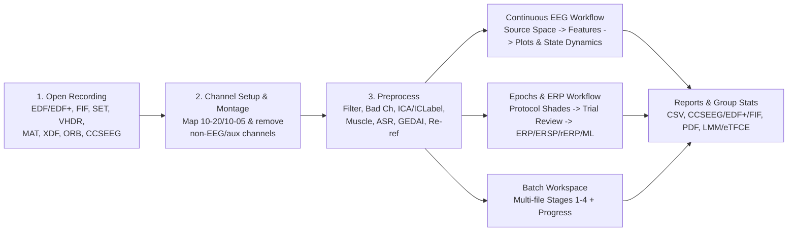

# CCS EEG Studio Wiki

A visual, step-by-step guide to **CCS EEG Studio** (`v1.2.66`, light clinical desktop theme matching **CCS Sleep Studio**) — native-speed EEG preprocessing, physiological event extraction (blinks, eye movements, EMG surges, ECG R-peaks for HEP/strain), feature extraction, state dynamics, microstates, ERP/ERSP/rERP/ML analysis, preprocessing outcome logs, and batch reporting without Python or MATLAB dependencies.

- **Universal macOS & Windows Reliability:** Built natively for both **Apple Silicon (`arm64`) and Intel (`x86_64`) Macs**, with Windows 8 MB worker stacks, long-path handling, and persistent green workflow-module completion ticks across tab transitions.

---

## End-to-End Workflow Map

---

## Wiki Pages

| Guide | What It Covers |
| :--- | :--- |
| [**1. Continuous & Preprocessing**](Continuous-and-Preprocessing.md) | File import (Rust XDF/EDF/FIF/SET/VHDR), unlocated channel guard, interactive preprocessing preview, GEDAI/ICA/ASR, source projection |
| [**2. Features & State Dynamics**](Features-and-State-Dynamics.md) | Spectral (PSD/FOOOF/IRASA), connectivity, nonlinear metrics (DFA/fE:I), microstates, feature plots, all-states feature mapping |
| [**3. Epochs & ERP Suite**](Epochs-and-ERP-Suite.md) | 3-step ERP flow, protocol epoch shades, ERPimage, Distributed, Butterfly + separate GFP, ERP & Topo, ERSP & ITC, rERP & ML, Measurements |
| [**4. Batch & Group Statistics**](Batch-and-Group-Statistics.md) | Multi-file Stage 1–4 pipeline, step toggles, live progress monitor, grand-average review, group statistics & shortcuts |
| [**5. Synced Video/Audio & Speech Tracking**](Video-Audio-and-Speech-Tracking.md) | Multi-video/audio timestamp sync, waveform + speech envelope, Neural Speech Tracking (TRF & Decoder) |

---

## Supported Inputs & Native Outputs

| Category | Formats / Outputs |
| :--- | :--- |
| **Input Recordings** | `.edf`, `.bdf`, `.fif`, `.set`, `.vhdr`, `.mat` (FieldTrip), `.xdf` (Rust accelerated), `.orb` / `.signal`, `.ccseeg` |
| **Saved Recordings** | `.edf` (EDF+ 16-bit + `.ccsmeta`), `.fif` (32-bit float), `.ccseeg` (portable native JSON) |
| **Analysis Exports** | Feature `.csv`, ERP measurements `.csv` & `.ccserp`, Microstate syntax `.csv`, Publication SVG/PNG plots, Summary `.pdf` |

---

## Additional Technical References

- [Method Validation & References](../methods_and_validation.md)
- [Release & CI Preflight SOP](../RELEASE_SOP.md)
- [ERP Workbench Guide](../erp_workbench.md)
- [Microstate Syntax Reference](../microstate_syntax.md)
- [Source & Information Graph Connectivity](../source_information_graph.md)
- [Multi-User Linux Server Controls](../server_and_plot_controls.md)

---

## Method References Overview

All signal processing, spectral/fractal parameterization, functional connectivity, microstates, ERP/e-TFCE, 3-shell XPIKAN source modeling, and mTRF speech-tracking algorithms cite peer-reviewed publications and open reference implementations in each guide below and in the [Method References Table](../../README.md#-method-references).
