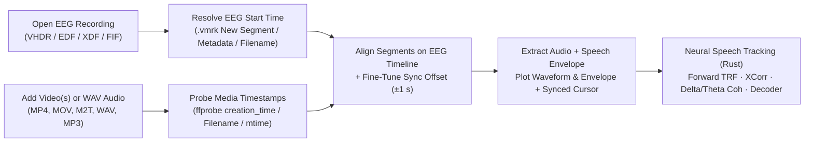

# 5. Synced Video/Audio & Neural Speech Tracking

[← Batch & Group Statistics](Batch-and-Group-Statistics.md) · [Wiki Home](Home.md)

---

## Visual Flow

---

## Key Features

- **Multi-Video & Standalone Audio Sync:** Load one or multiple timestamped video files or standalone `.wav`/audio recordings from the **Video / Audio** button in the top bar.
- **Streamed Audio Waveform & Envelope Alongside Features:** Automatically extracts mono audio (`ffmpeg`), streams huge `.wav` files in constant memory, computes auditory power-law (`env^0.3`) Hilbert envelopes (`1–15 Hz`), and displays the synced **Audio & Envelope** strip directly under **Plots & Report (TopoStats)** with bidirectional click-to-seek cursor sync.
- **Neural Speech Tracking (mTRF):** Click **Neural Speech Tracking** inside the synced media panel to run anti-aliased `1–15 Hz` EEG & envelope preprocessing, 5-fold cross-validated **Crosse et al. (2016) mTRF** forward encoding (with finite-difference Tikhonov smoothness `M` and CV `lambda`), lagged cross-correlation, delta/theta coherence, multi-channel **backward stimulus-reconstruction decoding**, and a one-tailed **circular-shift permutation null test (`N=200`)**.

---

## Method References

| Component | Reference |
| :--- | :--- |
| **Multivariate Temporal Response Functions (`mTRF`)** | Crosse, Di Liberto, Bednar & Lalor (2016), *Front. Hum. Neurosci.* 10:604, [doi:10.3389/fnhum.2016.00604](https://doi.org/10.3389/fnhum.2016.00604) |
| **Auditory Power-Law Speech Envelope (`env^0.3`)** | Biesmans, Das, Francart & Bertrand (2017), *IEEE Trans. Neural Syst. Rehabil. Eng.* 25(5):402–412, [doi:10.1109/TNSRE.2016.2571900](https://doi.org/10.1109/TNSRE.2016.2571900) |
| **Neural Tracking of Continuous Speech** | Ding & Simon (2012), *PNAS* 109(29):11854–11859, [doi:10.1073/pnas.1205381109](https://doi.org/10.1073/pnas.1205381109) |
