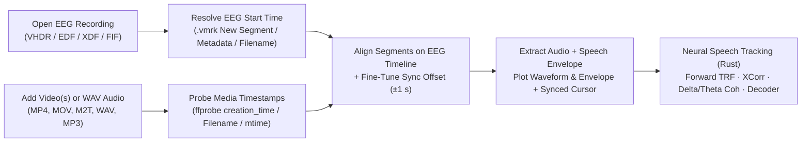

# 5. Synced Video/Audio & Neural Speech Tracking

[← Batch & Group Statistics](Batch-and-Group-Statistics.md) · [Wiki Home](Home.md)

---

## Visual Flow

---

## Key Features

- **Multi-Video & Standalone Audio Sync:** Load one or multiple timestamped video files or standalone `.wav`/audio recordings from the **Video / Audio** button in the top bar.
- **Audio Waveform & Envelope Extraction:** Automatically extracts mono 16 kHz audio from video (`ffmpeg`) and computes min/max waveform bins + smoothed 12 Hz speech envelope in Rust (`extract_audio_envelope`).
- **Neural Speech Tracking:** Click **Neural Speech Tracking** inside the synced media panel to run 5-fold cross-validated ridge **Temporal Response Function (TRF)** forward encoding, peak cross-correlation lag, delta/theta speech-brain coherence, and multi-channel **backward stimulus-reconstruction decoding**.
