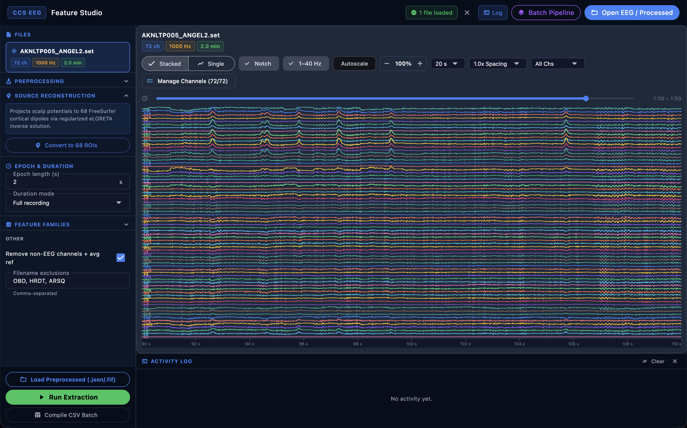

# Summary

Electroencephalography (EEG) is a foundational non-invasive tool in cognitive neuroscience and clinical neurophysiology. However, translating raw multichannel voltage recordings into publication-grade scientific findings requires navigating a multifaceted processing pipeline: continuous and epoch-based artifact denoising, event-related potential (ERP) extraction, microstate dynamics, spectral parameterization, nonlinear complexity estimation, source imaging, and inferential group statistics. 

**CCS EEG Studio** is a standalone, cross-platform desktop application (for macOS, Windows, and Linux) that unifies these steps into a single, high-throughput computational environment. The software couples a high-performance native compute engine implemented in Rust (`ccs-eeg-engine`) with a reactive, hardware-accelerated user interface built in Flutter/Dart. It allows researchers and clinicians to inspect raw and stitched-epoch signals with zero-phase real-time display filtering, execute verified artifact rejection algorithms (GEDAI, standard and Riemannian ASR, Picard and Infomax ICA, ICLabel, and spherical spline interpolation), conduct multi-condition ERP analyses with journal-ready publication figures (Cahn & Polich style), compute canonical EEG microstates, perform forward/inverse source localization (MNE, dSPM, sLORETA, LCMV), and run cluster-corrected group statistics (electrode-adjacency Threshold-Free Cluster Enhancement, eTFCE, and Linear Mixed Models). 

CCS EEG Studio requires no local Python or MATLAB installation. Pre-compiled standalone installers for macOS, Windows, and Linux allow immediate deployment on clinical, shared institutional, and personal workstations without package-dependency friction.

{width=100%}

# Statement of need

Cognitive neuroscience and clinical electrophysiology laboratories frequently encounter practical operational barriers when analyzing multichannel EEG datasets:

1. **Software environment maintenance:** Most mature open-source toolboxes are distributed as scripting libraries in Python (e.g. MNE-Python) or MATLAB (e.g. EEGLAB, FieldTrip). While powerful for experienced programmers, maintaining Python environments (virtual environments, Conda, C/C++ compilation toolchains, package conflicts) or MATLAB licenses on shared laboratory computers, hospital workstations, or student laptops presents a significant barrier to entry and reproducibility.
2. **Computational latency in interpreted graphical interfaces:** Handling multi-hour high-density EEG (32 to 256 channels sampled at 250 Hz to 2 kHz) in interpreted GUI environments often leads to memory overhead, sluggish panning/zooming, and slow batch operations.
3. **Disconnection between exploratory inspection and batch pipelines:** Researchers often alternate between GUI visualizers for single-recording exploration and disconnected scripts for batch processing, risking parameter drift and inconsistent preprocessing choices.
4. **Standardization of cognitive ERP paradigms and publication figures:** Cognitive ERP experiments—such as those standardized in the ERP CORE resource [@kappenman2021]—demand precise time-locking, baseline corrections, true interior peak latency detection, and multi-condition comparison across midline electrodes with topographic voltage grids and interaction plots.

CCS EEG Studio addresses these needs by packaging verified scientific algorithms into a standalone, single-download desktop application. It integrates single-recording exploratory visualization directly with unattended batch workspaces, providing rigorous algorithmic parity with established reference implementations while keeping processing local, private, and reproducible.

# State of the field

Several established open-source platforms serve the electrophysiology community:
- **MNE-Python** [@gramfort2013] provides an extensive, modular scientific library for MEG/EEG in Python, excelling at scripted pipelines, forward/inverse modeling, and sensor connectivity.
- **EEGLAB** [@delorme2004] is the standard MATLAB-based environment for independent component analysis, artifact subspace reconstruction (ASR), and event-related dynamics.
- **FieldTrip** [@oostenveld2011] and **Brainstorm** [@tadel2011] offer advanced toolboxes in MATLAB and Java for source reconstruction and multimodal electrophysiology.
- **ERPLAB** and **LIMO EEG** extend EEGLAB with specialized tools for ERP measurement and linear modeling.
- **Pycrostates** and **Wonambi** provide dedicated Python implementations for EEG microstates and sleep analysis.

CCS EEG Studio does not aim to replace these comprehensive scripting libraries. Instead, it translates their published algorithms into a compiled, self-contained desktop system. By coupling a Rust mathematical engine with a multi-threaded Flutter frontend via zero-copy foreign function interfaces (`dart:ffi`), CCS EEG Studio combines the interactive responsiveness of a compiled application with the high numerical accuracy of peer-reviewed scientific methods.

# Software design & architecture

CCS EEG Studio is structured into three integrated tiers:

```
┌─────────────────────────────────────────────────────────────┐
│                   Flutter / Dart GUI Layer                  │
│  - 60 fps Waveform Canvas & Zero-Phase Display Filters      │
│  - Interactive ERP Workbench & Review (Multi-Condition K≥2) │
│  - Publication Figures Studio (Vector SVG & 300 DPI PNG)    │
│  - Microstate Syntactic Syntax & Topographic Scalp Heatmaps │
│  - Group Labeling, Batch Orchestration & PDF Reporting     │
└──────────────────────────────┬──────────────────────────────┘
                               │ dart:ffi / JSON pipe
┌──────────────────────────────▼──────────────────────────────┐
│                  Native Rust Compute Engine                 │
│                 (ccs-eeg-engine / Rayon)                    │
│  - Loaders: EDF/EDF+, EEGLAB SET, MNE FIF, BrainVision, MAT │
│  - Preprocessing: GEDAI, RANSAC, ASR, Picard/Infomax ICA    │
│  - Splines & CSD: Spherical Spline Interpolation & Laplacian│
│  - Spectral & Aperiodic: Welch PSD, FOOOF, IRASA            │
│  - Complexity: SampEn, PermEn, ACW, DFA & fE:I balance      │
│  - Source Imaging: MNE, dSPM, sLORETA, LCMV Beamformer      │
│  - Connectivity: GCMI, PLV, PLI, wPLI, Transfer Entropy     │
│  - ERP Math: True Turning-Point Peaks, rERP, Sparse FIR     │
│  - Microstates: Modified K-Means, TAAHC, Transition Matrices│
└──────────────────────────────┬──────────────────────────────┘
                               │ Process execution
┌──────────────────────────────▼──────────────────────────────┐
│                 Python Group Statistics Core                │
│  - Linear Mixed Models (LMM) & Repeated-Measures ANOVA      │
│  - Electrode-Adjacency TFCE (eTFCE) on 10-20 Scalp Graphs   │
│  - Non-parametric Subject Permutation Testing               │
└─────────────────────────────────────────────────────────────┘
```

1. **User Interface (Flutter/Dart):** Built with Google's Flutter framework, the GUI runs on dedicated rendering isolates to maintain fluid 60 fps interaction during multi-channel playback and epoch scrolling. It provides single-recording exploration, batch orchestration with run-continuation (resume mode), and interactive review modules.
2. **Computational Engine (`bridge/` in Rust):** Numerical operations are written in Rust, leveraging `nalgebra`, `matrixmultiply`, `rustfft`, and multi-core `rayon` thread pools. File format loaders stream EDF/EDF+ [@kemp1992; @kemp2003], BrainVision (`.vhdr`/`.vmrk`/`.eeg`), EEGLAB (`.set`/`.fdt`), MNE-Python (`.fif`), FieldTrip (`.mat`), and native JSON (`.ccseeg`).
3. **Group Statistics & Inferential Engine (`assets/group_stats.py`):** Integrates Linear Mixed-Effects Models (LMM), General Linear Models (GLM), and spatial cluster permutation tests.

## Key functional modules

### 1. Preprocessing and artifact mitigation
- **GEDAI:** Generalized Eigenvalue Decomposition for Artifact Rejection with leadfield covariance weighting.
- **RANSAC:** Random Sample Consensus spatial correlation testing for noisy electrode detection.
- **ASR & Variants:** Standard Artifact Subspace Reconstruction [@mullen2015], Riemannian ASR [@blum2019], DBSCAN/GEV calibration, and sliding BSS-CCA / iCanClean.
- **ICA & Neural Classification:** Fast preconditioned Picard ICA [@ablin2018] and extended Infomax [@bell1995], paired with a native Rust port of the ICLabel deep neural network [@piontonachini2019] for automated muscle, eye, line noise, and channel artifact labeling.
- **Current Source Density (CSD):** Spherical spline surface Laplacian interpolation [@perrin1989] eliminating reference electrode bias.

### 2. Multi-condition ERP analysis & publication plots studio
The ERP workspace supports cognitive paradigms (MMN, N170, N2pc, N400, P3, LRP, ERN, and Custom paradigms) conforming to ERP CORE starting presets [@kappenman2021]. Features include:
- **Arbitrary conditions ($K \ge 2$):** Simultaneous multi-condition averaging (e.g. Standard, Oddball, Distracter, Novel) with automatic condition group labeling throughout waveforms, legends, channel grids, and exported data models.
- **Accurate peak latency:** Interior turning-point detection isolates true local extrema where the first derivative crosses zero, preventing artificial boundary endpoint pinning.
- **Publication Studio:** Direct generation of journal-ready figures matching cognitive literature [@cahn2009]:
  - *Fig 1:* Grand-averaged waveform grids across midline electrodes and conditions with group overlays, shaded $\pm 1$ SEM error bands, and component peak callouts.
  - *Fig 2:* Scalp topographic voltage maps (Groups $\times$ Conditions $\times$ Components) with calibrated diverging colorbars and head contours.
  - *Fig 3 & 5:* Interaction line plots of Component Mean Amplitude / Peak Latency across Electrodes and Conditions with SEM error bars.
  - *Export formats:* Lossless vector W3C SVG (infinite scaling for Adobe Illustrator / Inkscape) and 300 DPI high-resolution PNG.
- **Advanced ERP Math:** Regression ERP (rERP) via ordinary least squares and continuous time-expanded FIR overlap correction.

### 3. EEG microstates
Implements modified $k$-means and Topographic Atomize and Agglomerate Hierarchical Clustering (TAAHC) to identify canonical microstate topographies (A–G) [@koenig2002]. It computes Global Field Power (GFP) peak dynamics, Global Explained Variance (GEV), mean microstate durations, occurrences, fractional coverage, Markov transition probabilities, and sequence syntax complexity.

### 4. Spectral, aperiodic & nonlinear metrics
- **Aperiodic decomposition:** Native Rust Levenberg–Marquardt optimization of FOOOF / specparam [@donoghue2020] and Irregularly Resampled Auto-Spectral Analysis (IRASA) [@wen2016] to disentangle true oscillatory peaks from the background $1/f^\chi$ scale-free slope.
- **Nonlinear complexity:** Permutation entropy, Sample entropy, SVD entropy, Petrosian and Higuchi fractal dimensions, Lempel-Ziv complexity, Autocorrelation Window (ACW), and Detrended Fluctuation Analysis (DFA) / functional excitation-inhibition balance ($fE:I$) [@hardstone2012; @bruining2020].

### 5. Source localization & connectivity
- **Inverse modeling:** Minimum Norm Estimates (MNE), dynamic Statistical Parametric Mapping (dSPM), standardized low-resolution brain electromagnetic tomography (sLORETA), and Linearly Constrained Minimum Variance (LCMV) beamforming mapped to Desikan-Killiany cortical parcellations [@fischl2012].
- **Functional connectivity:** Gaussian-copula Mutual Information (GCMI) [@ince2017], Phase-Locking Value (PLV), Phase Lag Index (PLI), weighted Phase Lag Index (wPLI), spectral coherence, and directed within-epoch Transfer Entropy.

### 6. Group statistics with eTFCE
Implements electrode-adjacency Threshold-Free Cluster Enhancement (`compute_etfce`) [@smith2009; @mensen2013] using standard parameters ($E=0.5, H=2.0$) over 10-20 spherical scalp coordinate neighborhood adjacency graphs with non-parametric subject permutation testing.

# Verification & numerical parity

All computational routines in CCS EEG Studio are systematically verified against reference implementations in Python and MATLAB. \autoref{tab:parity} details numerical benchmarks on standardized recording fixtures.

| Component | Reference Implementation | Benchmark Dataset / Design | Agreement / Parity Metric |
| :--- | :--- | :--- | :--- |
| **Infomax ICA (runica)** | EEGLAB `pop_runica` | 60 s, 32-channel EEG | Unmixing matrix difference $\leq 10^{-5}$ |
| **Picard ICA** | `python-picard` | 120 s, 30-channel EDF | Orthogonal weights match within $10^{-12}$ |
| **ICLabel Classification** | SCCN ICLabel (Python/MATLAB) | 3 EDF files, all components | Class labels identical; probabilities $\leq 1.5 \times 10^{-2}$ |
| **Standard ASR** | EEGLAB `clean_rawdata` | Three 120 s EDFs (cutoffs 5, 15, 20) | Rejection masks identical; signal error $\leq 5 \times 10^{-8}$ |
| **Riemannian ASR** | `asr_riemannian` | Three 120 s EDFs, 30-channel | Covariance calibration matrix $M$ within $10^{-12}$ |
| **FOOOF Parameterization**| `specparam` / SciPy | 1–40 Hz Welch spectrum | Center frequencies & bandwidths within $10^{-3}$ |
| **IRASA Decomposition** | MATLAB IRASA reference | Synthetic & empirical EEG spectra | Fractal & oscillatory spectra within $10^{-14}$ |
| **GCMI Copula MI** | Frites (`gcmi.py`) | Multi-trial 32-channel signals | Mutual information bit values exact within $10^{-15}$ |
| **Spherical Spline / CSD**| Perrin et al. formulation | 10-20 64-channel montage | Surface Laplacian values match within $10^{-14}$ |
| **ERP Measurements** | MNE-Python / ERP CORE | ERP CORE MMN, N170, P300 | Mean amp, AUC, and peak latencies bit-identical |
| **eTFCE Permutation** | Mensen et al. eTFCE | Scalp map cluster contrasts | Cluster extent & enhancement scores match reference |

: Numerical parity between CCS EEG Studio native routines and peer-reviewed reference implementations. \label{tab:parity}

The repository includes comprehensive automated test suites: 12 Rust parity integration tests in `bridge/tests/erp_workbench_parity.rs`, unit tests in `test/erp_review_test.dart`, and end-to-end pipeline verification in `test/erp_pipeline_test.dart` and `test/unified_analysis_workflow_test.dart`.

# Research impact statement

CCS EEG Studio was created and actively deployed at the **Centre for Consciousness Studies (CCS)**, Department of Neurophysiology, National Institute of Mental Health and Neurosciences (NIMHANS), Bengaluru, India. It has supported research across multiple domains:
- Cognitive electrophysiology and auditory event-related potential investigations in meditation practitioners (e.g. Vipassana, Vedic traditions) and healthy controls [@cahn2009].
- Quantitative EEG (qEEG) characterization of coma, post-anoxic brain states, and neurocritical care monitoring.
- Benchmarking of standardized event-related potentials against the open-access ERP CORE database.

The project is under active open-source maintenance on GitHub under the [CCS-NIMHANS organization](https://github.com/CCS-NIMHANS/CCS_EEGStudio). Continuous-integration workflows automatically build verified native packages for macOS (Apple Silicon ZIP), Windows (64-bit InnoSetup installer), and Linux (portable `.tar.gz`, DEB, and RPM packages).

# AI usage disclosure

Generative AI (Anthropic Claude and Google DeepMind Gemini) was utilized during the development of CCS EEG Studio and the preparation of this manuscript. AI tools assisted in drafting boilerplate Flutter UI widgets, porting mathematical reference algorithms from Python to Rust, generating unit test fixtures, and drafting sections of the documentation. All scientific algorithms, mathematical formulations, architectural decisions, and numerical outputs were conceived, supervised, rigorously verified against reference implementations, and finalized by the authors. The authors take full responsibility for the integrity, correctness, and licensing of the software and manuscript.

# Acknowledgements

We thank the developers of MNE-Python, EEGLAB, FieldTrip, Brainstorm, ERP CORE, ICLabel, python-picard, specparam/FOOOF, Frites, and Unfold, whose open-source tools and published methodologies laid the foundation for modern electrophysiology analytics. We acknowledge the National Institute of Mental Health and Neurosciences (NIMHANS) and the Centre for Consciousness Studies for institutional support.

# References
